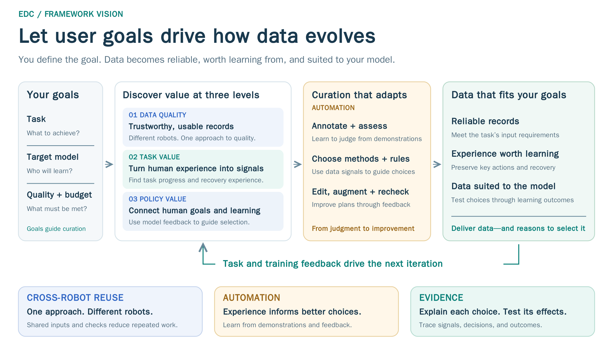
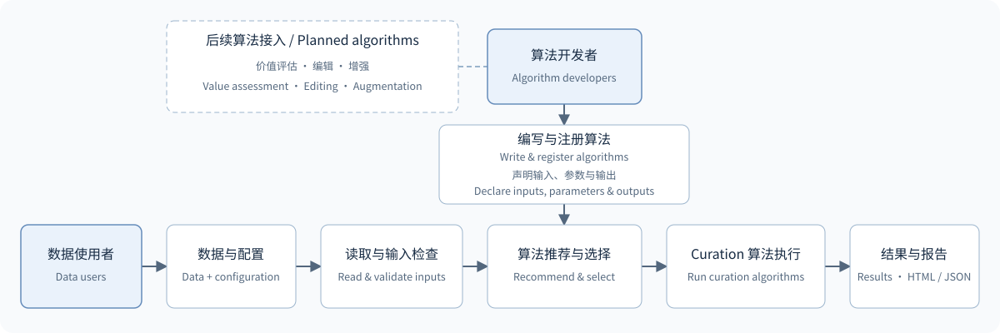

# Embodied Data Curation Framework

**EDC = Embodied Data Curation**. A data curation framework for robot data users and algorithm developers.

[简体中文](README.zh-CN.md) · [Documentation](https://singlesingerdht.github.io/embodied-data-curation/index.en.html) · [Quick start](https://singlesingerdht.github.io/embodied-data-curation/QUICKSTART.html) · [Data integration](https://singlesingerdht.github.io/embodied-data-curation/DATA_AND_CONFIGURATION.html) · [Algorithms](https://singlesingerdht.github.io/embodied-data-curation/ALGORITHMS.html) · [Development](https://singlesingerdht.github.io/embodied-data-curation/DEVELOPMENT.html)

## Overview

**Take robot data from “usable” to “worth learning from.”** EDC aims to discover the potential of embodied data and curate reliable, valuable datasets for target tasks and policy models.



**User needs** include the task and success criteria, target policy, quality requirements, and data/computing budget, with expert demonstrations or reliable references where applicable. Today, users receive quality reports, issue evidence, selected data copies or symlinks, and source manifests. Planned outputs add task annotations and data subsets or improved versions suited to the target policy. [Needs and deliverables](https://singlesingerdht.github.io/embodied-data-curation/QUALITY_VALIDATION.html#quality-validation-needs)

- **Data quality | Different robots. One approach to quality checks.** Make data from different robots readable and interpretable by machines, with reusable quality checks.
- **Task value | Turn human understanding into machine learning signals.** Draw on expert demonstrations and task requirements to identify key actions and corrective experience worth learning.
- **Policy value | Connect human goals and machine learning through feedback.** Use goals, reference experience, and model training feedback to identify helpful data, reducing repeated real-robot evaluations during selection.

Across these three levels, the framework pursues two further advantages:

- **Automation | Learn to assess from experience; improve choices through feedback.** Learn assessment criteria from expert demonstrations and use data and training feedback to guide selection, progressively reducing manual assessment, rule adjustment, and method selection. [Mechanisms and research evidence](https://singlesingerdht.github.io/embodied-data-curation/QUALITY_VALIDATION.html#quality-validation-automation)
- **Evidence | Trace the basis of each choice and test its effects.** Connect selection to quality evidence, task progress, and model learning signals; record processing steps and validate choices with independent feedback. [Verifying choices](https://singlesingerdht.github.io/embodied-data-curation/QUALITY_VALIDATION.html#quality-validation-evidence)

> Data quality checks are available today. Task-value and policy-value methods have research foundations and will be integrated progressively.

> **Long-term goal: you set the objective; the framework keeps exploring autonomously—which data to keep, which experience to learn from, and what to improve next.**

See [From Quality Checks to Autonomous Data Curation](https://singlesingerdht.github.io/embodied-data-curation/QUALITY_VALIDATION.html) for the three levels, research foundations, and validation plans, or the [presentation (Chinese)](docs/presentations/edc-framework.zh-CN.pptx). Readers cover LeRobot, HDF5, Parquet, ROS bags, MCAP, and more; see [supported formats](https://singlesingerdht.github.io/embodied-data-curation/DATA_AND_CONFIGURATION.html#data-and-configuration-formats) for conditions.

## What's New

> 🚀 The Embodied Data Curation Framework repository is coming soon. Stay tuned!

## Architecture and Modules



- **Data users**: provide data and robot configuration → review recommendations and select algorithms → run, inspect reports, and export data.
- **Algorithm developers**: write algorithms and declare inputs/outputs → register and validate → join the same recommendation and execution flow.

Both paths share input checks, execution, and result recording. [Modules and extensions](https://singlesingerdht.github.io/embodied-data-curation/DEVELOPMENT.html#development-interfaces)

## Installation and Quick Start

Python 3.10 or later is required. Run from a repository checkout and replace `/path/to/...` with local paths.

**1. Install**

```bash
cd /path/to/embodied-data-curation
python -m venv .venv
source .venv/bin/activate
pip install '.[formats]'
```

**2. Prepare data**

Place a real X1 Pro dual-arm MCAP recording matching [`x1pro_mcap.yaml`](configs/robots/x1pro_mcap.yaml) at `/path/to/dataset/episode.mcap`. [Sample details and availability](https://singlesingerdht.github.io/embodied-data-curation/QUICKSTART.html#quickstart-data)

**3. Run and view results**

```bash
edc batch /path/to/dataset/episode.mcap \
  --robot configs/robots/x1pro_mcap.yaml \
  --output /path/to/results/report.html --jobs 1
```

Open `/path/to/results/report.html` in a browser; `report.json` is saved alongside it. Successful execution does not mean all data passed. [Full quick start](https://singlesingerdht.github.io/embodied-data-curation/QUICKSTART.html)

**4. Export selected data (optional)**

Export from the batch `report.json`; only records marked for retention (`keep`) are selected by default. Choose one mode:

```bash
# Copy data
edc regenerate /path/to/results/report.json --output /path/to/selected --mode copy

# Or create symbolic links to the original data
edc regenerate /path/to/results/report.json --output /path/to/selected-links --mode link
```

Output includes copies or links and a source manifest, `manifest.json`. Originals stay unchanged; links require the sources to remain available. [Export and limitations](https://singlesingerdht.github.io/embodied-data-curation/SELECTION.html?lang=en)

## Data and Configuration

Dataset information describes file locations, tasks, and operation boundaries; robot configuration defines field meanings; algorithm parameters set the scope and criteria for this run.

**Robot configuration declares which arms exist; algorithm configuration selects which arms to inspect.** `arms: all` checks all declared arms, `[left]`/`[right]` selects one side, and `main` can represent an independent single arm. Reuse one robot configuration across tasks.

| Task | Documentation |
|---|---|
| Inspect fields, formats, and operation boundaries | [Dataset integration](https://singlesingerdht.github.io/embodied-data-curation/DATA_AND_CONFIGURATION.html#data-and-configuration-dataset) |
| Map source fields and configure one or two arms | [Robot configuration](https://singlesingerdht.github.io/embodied-data-curation/DATA_AND_CONFIGURATION.html#data-and-configuration-robot) |
| Confirm units, time sources, and clocks | [Units and time](https://singlesingerdht.github.io/embodied-data-curation/DATA_AND_CONFIGURATION.html#data-and-configuration-units-time) |
| Inspect URDF joints and validate configuration | [URDF usage and limits](https://singlesingerdht.github.io/embodied-data-curation/DATA_AND_CONFIGURATION.html#data-and-configuration-urdf) |
| Set algorithm inputs, scope, and parameters | [Algorithm configuration](https://singlesingerdht.github.io/embodied-data-curation/ALGORITHMS.html#algorithms-selection) |

Values with unknown units can be retained and checked for NaN/Inf, but cannot support physical calculations requiring known units.

## Algorithm Recommendation and Execution

Recommendations list **fully available, partly available, and unavailable** algorithms, with the scope they can check and missing requirements. Execution determines whether data passes.

```bash
# Data-specific recommendations: this script calls edc.recommend()
python examples/quickstart/recommend.py /path/to/dataset/episode.mcap \
  --robot configs/robots/x1pro_mcap.yaml

# Select algorithms and execute in the specified order
edc run /path/to/dataset/episode.mcap \
  --robot configs/robots/x1pro_mcap.yaml \
  --algorithm Structure_Check --algorithm Numeric_Check \
  --output /path/to/results/selected
```

`run` preserves the specified order; without a selection, it attempts fully and partly available quality methods and records missing requirements. `batch` runs the quality collection on one recording, several recordings, or a directory. `edc algorithms` only lists registered algorithms. [Selection and Python API](https://singlesingerdht.github.io/embodied-data-curation/ALGORITHMS.html#algorithms-selection)

The example writes `/path/to/results/selected/report.html`, using the same four sections as batch. `--no-html` disables single-run HTML while preserving JSON and evidence. Batch produces one combined HTML report and a `report.json` for export; `--keep` retains full per-recording results. [Reports and evidence](https://singlesingerdht.github.io/embodied-data-curation/ALGORITHMS.html#algorithms-results)

| Algorithm | Checks | Minimum input | Details |
|---|---|---|---|
| `Structure_Check` | Channels, cameras, and duration | Channel list and structural requirements | [Structure](https://singlesingerdht.github.io/embodied-data-curation/ALGORITHMS.html#algorithms-structure-check) |
| `Numeric_Check` | Finite values and configured physical limits | Numeric fields; physical checks also need units and limits | [Numeric validity](https://singlesingerdht.github.io/embodied-data-curation/ALGORITHMS.html#algorithms-numeric-check) |
| `Action_Smoothness` | End-effector vibration while holding still and stuck readings | XYZ feedback and a usable timeline | [Smoothness](https://singlesingerdht.github.io/embodied-data-curation/ALGORITHMS.html#algorithms-action-smoothness) |
| `Check_Timestamp` | Timing correspondence between images and other data, and sampling regularity per stream | Valid timestamps with known units | [Timestamps](https://singlesingerdht.github.io/embodied-data-curation/ALGORITHMS.html#algorithms-check-timestamp) |
| `Sync_Check` | Recording span coverage and clock offsets across streams | Independent acquisition times and comparable clocks; differences also need record times | [Synchronization](https://singlesingerdht.github.io/embodied-data-curation/ALGORITHMS.html#algorithms-sync-check) |
| `Root_Cause` | Single-stream gaps, simultaneous interruptions, and periodic anomalies | Comparable timelines and source groups | [Timing attribution](https://singlesingerdht.github.io/embodied-data-curation/ALGORITHMS.html#algorithms-root-cause) |
| `Dedup_Check` | Repeated timestamps or sequence numbers | Original times or sequence information | [Duplicates](https://singlesingerdht.github.io/embodied-data-curation/ALGORITHMS.html#algorithms-dedup-check) |
| `Reset_Detection` | Distance from Home at the start and end | Position feedback, Home, and tolerances | [Reset](https://singlesingerdht.github.io/embodied-data-curation/ALGORITHMS.html#algorithms-reset-detection) |
| `Video_Integrity` | Image content and video integrity | Decodable frames or video | [Images and video](https://singlesingerdht.github.io/embodied-data-curation/ALGORITHMS.html#algorithms-video-integrity) |

Each algorithm retains its own metrics and evidence, without a combined score. [Check rationale and research directions](https://singlesingerdht.github.io/embodied-data-curation/QUALITY_VALIDATION.html)

## Developers and Project Structure

New quality algorithms can reuse unified data reading, input validation, and report rendering. Follow the existing template, declare inputs and parameters, and register the algorithm to join the same recommendation and execution flow.

Quality algorithms can inherit `QualityAlgorithm` and return a list of `Item` objects containing reasons, metrics, and evidence. They can also return `AlgorithmResult` with an optional one-line summary for the report. General plugins use `AlgorithmSpec + run(context, params)`.

[Output classes and adding a new algorithm](https://singlesingerdht.github.io/embodied-data-curation/DEVELOPMENT.html#development-quality-example) · [Reader plugins](https://singlesingerdht.github.io/embodied-data-curation/DEVELOPMENT.html#development-readers) · [Contributing (Chinese)](CONTRIBUTING.md)

```text
src/edc/
├── data/          # Data interfaces, readers, and transforms
├── robots/        # Configuration, parts, and channel meanings
├── algorithms/    # Registration, preflight, nine quality methods, and output classes
├── execution/     # CLI, single-run, and batch execution
├── workflows/     # Optional stages and quality recheck interfaces
└── reporting/     # Reports and evidence
configs/
├── robots/        # Robot YAML and associated URDF
└── templates/     # Single-arm, dual-arm, and other templates
examples/          # Usage and plugin examples
docs/              # Topic guides
tests/             # Contract and implementation tests
```

### Roadmap

These are planned integrations or research directions. See the [quality guide](https://singlesingerdht.github.io/embodied-data-curation/QUALITY_VALIDATION.html#quality-validation-layers) for methods and foundations:

1. Task segmentation, progress assessment, and useful segment discovery: STEAM and MGT-QV.
2. Automatic annotation against task criteria and multimodal review: drawing on external work such as FLORA.
3. Data editing, demonstration resampling, and quality rechecks: directions such as DemoTempo.
4. Selection for target policies: RoboDrop and VLA as a judge.
5. Feedback-driven rules and algorithm combinations, then new algorithm generation, validation, and integration toward [autonomous curation](https://singlesingerdht.github.io/embodied-data-curation/QUALITY_VALIDATION.html#quality-validation-autonomous).
