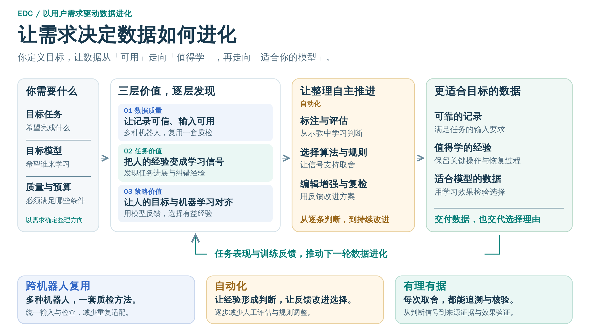
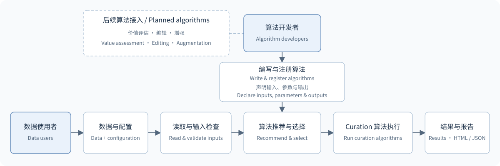

# Embodied Data Curation Framework · 具身数据整理框架

**EDC = Embodied Data Curation**。面向具身数据使用者与算法开发者的数据整理框架。

[English](README.md) · [EDC · 具身数据整理框架](https://singlesingerdht.github.io/embodied-data-curation/index.html) · [快速开始](https://singlesingerdht.github.io/embodied-data-curation/tutorial/QUICKSTART.zh-CN.html) · [数据与机器人配置](https://singlesingerdht.github.io/embodied-data-curation/how-to/DATA_AND_ROBOT.zh-CN.html) · [内置质量算法参考](https://singlesingerdht.github.io/embodied-data-curation/reference/ALGORITHMS.zh-CN.html) · [算法扩展](https://singlesingerdht.github.io/embodied-data-curation/how-to/ALGORITHM_PLUGIN.zh-CN.html)

## 框架概览

**让机器人数据，从“可用”走向“值得学”。** EDC 致力于发现具身数据的潜力，为目标任务和策略模型整理可靠、有价值的数据。



**用户需求**包括任务与成功条件、目标策略、质量要求和数据／计算预算，适用时提供专家示教或可靠参考数据。框架提供质检报告、问题证据、筛选数据副本或软链接及来源清单。[需求与交付](https://singlesingerdht.github.io/embodied-data-curation/explanation/QUALITY_VALIDATION.zh-CN.html#quality-validation-zh-cn-needs)

- **数据质量｜多种机器人，一套质检方法。** 让不同机器人的数据可被机器正确读取与解释，让质量检查跨设备复用。
- **任务价值｜把人类理解，变成机器的学习信号。** 从专家示范和任务要求中，提炼值得学习的关键动作与纠错经验。
- **策略价值｜让人的目标，与机器的学习在反馈中对齐。** 以目标与参考经验为依据，用模型训练反馈判断哪些数据有助于学习，减少反复真机筛选评估。

在三个层次之上，框架进一步追求两项优势：

- **自动化｜让经验形成判断，让反馈改进选择。** 从专家示教中学习评估依据，用数据与训练反馈支持筛选决策，逐步减少人工评估、规则调整和方法选择。[机制与论文依据](https://singlesingerdht.github.io/embodied-data-curation/explanation/QUALITY_VALIDATION.zh-CN.html#quality-validation-zh-cn-automation)
- **有理有据｜每次取舍，都能追溯依据、检验效果。** 将选择关联到质量证据、任务进展与模型学习信号，记录处理过程，并用独立反馈验证选择。[如何核验选择](https://singlesingerdht.github.io/embodied-data-curation/explanation/QUALITY_VALIDATION.zh-CN.html#quality-validation-zh-cn-evidence)

> 内置九项数据质量算法，并提供显式选择的首帧摆放检查、初始状态分布、任务进度归因和四事件安全检测价值算法；模型环境与权重另行准备。其他价值方法、增强和编辑可使用插件扩展，实际可运行范围取决于输入、依赖与标定。自主整理描述框架愿景，不代表默认安装已具备全部能力。

> **长期目标：你提出目标，框架持续自主探索——什么数据值得留，什么经验值得学，下一步该如何改进。**

三个层次、研究支撑与能力边界见[从质量检查到自主数据整理](https://singlesingerdht.github.io/embodied-data-curation/explanation/QUALITY_VALIDATION.zh-CN.html) · [演示文稿](docs/presentations/edc-framework.zh-CN.pptx)。读取器覆盖 LeRobot、HDF5、Parquet、ROS bag、MCAP 等，具体条件见[支持范围](https://singlesingerdht.github.io/embodied-data-curation/reference/DATA_AND_ROBOTS.zh-CN.html#data-and-robots-zh-cn-formats)。

## 最新动态

> 🎉 我们发布了 EDC 仓库首个版本，包含 9 项数据质量算法！<br>
> 🚀 四事件安全检测现已推出，与初始状态分布、任务进度归因一起通过 EDC 调用！

## 价值算法

除九项质量算法外，已内置首帧摆放检查、初始状态分布、任务进度归因与四事件安全检测四项价值算法，通过 `edc run` 显式调用。实现统一位于 `src/edc/algorithms/value/algorithms/<算法名>/`，各算法 README 提供模型下载、完整配置、运行步骤与结果说明。模型环境、权重和任务所需标定另行准备；`edc algorithms` 列出入口，`records.jsonl` 说明每次实际完成的评估。

| 算法 | 输入与输出 | 使用边界 |
|---|---|---|
| [首帧摆放检查](src/edc/algorithms/value/algorithms/Initial_Placement_Assessment/README.zh-CN.md) | 首帧 RGB 与明确的摆放要求 → 逐项符合、违反或无法判断及理由 | 每条轨迹独立检查，需要可用的视觉语言模型服务 |
| [初始状态分布](src/edc/algorithms/value/algorithms/Initial_State_Distribution/README.zh-CN.md) | 初始 RGB 帧、目标类别、SAM3 → 检测、网格分布、熵、有效比例与热力图 | 明确相机／场景分组；深度可选，不参与二维评分 |
| [任务进度归因](src/edc/algorithms/value/algorithms/Progress_Stagnation_Attribution/README.zh-CN.md) | 三视角图片／视频、子任务、GRM 与物理反馈 → 进度曲线、回退／停滞归因与证据 | 不要求固定 FPS；物理证据不足时保留视觉结果，但完整归因未完成；复核视频默认关闭 |
| [四事件安全检测](src/edc/algorithms/value/algorithms/Collision_Detection_Qwen3vl/README.zh-CN.md) | RGB、深度、机器人反馈与任务图 → 碰撞、洒漏、人手干预、盖子跌落的裁决与证据 | 支持原始帧和非固定帧率；需要适用标定；README 提供模型下载及倒茶配置示例 |

首帧摆放检查默认使用 `qwen3.8-max`。安装依赖后，设置环境变量 `DASHSCOPE_API_KEY`，复制示例配置并填写相机通道与采集 SOP 中的摆放要求。示例会将首帧和任务文本发送到配置的模型服务。 [配置示例](configs/robots/placement_example.yaml)

```bash
python -m pip install '.[placement,formats]'
edc run /path/to/dataset --robot /path/to/robot.yaml --algorithm Initial_Placement_Assessment --output /path/to/results
```

[安装与调用](docs/reference/VALUE_ALGORITHMS.zh-CN.md) · [独立模型环境](docs/reference/MODEL_ENVIRONMENTS.zh-CN.md)。请按各算法说明准备输入、模型依赖和适用标定。

请区分数据读取失败、算法缺输入／依赖与完成后无事件。`catalog.json` 索引记录和证据；命令成功退出不等于完整评估。更多价值算法即将发布。

价值算法与质量算法按用途分目录，执行和结果接口保持一致：

```text
src/edc/algorithms/
├── quality/algorithms/          # 9 项质量算法
├── value/algorithms/
│   ├── Initial_Placement_Assessment/
│   ├── Initial_State_Distribution/
│   ├── Progress_Stagnation_Attribution/
│   └── Collision_Detection_Qwen3vl/
├── augmentation/algorithms/     # 增强算法归属目录
└── editing/algorithms/          # 编辑算法归属目录
```

增强、编辑目录表示代码归属约定；实际可调用入口以 `edc algorithms` 为准。

## 架构与模块关系



- **数据使用者**：提供数据与机器人配置 → 查看推荐并选择算法 → 运行、查看报告及导出数据。
- **算法开发者**：编写算法并声明输入输出 → 注册与验证 → 接入同一套推荐和执行流程。

两类入口共用输入预检、执行与结果记录。[接口类型](https://singlesingerdht.github.io/embodied-data-curation/reference/OUTPUTS.zh-CN.html#outputs-zh-cn-interfaces)

## 安装与快速开始

需要 Python 3.10 或以上。在仓库源码中执行，将 `/path/to/...` 替换为本机路径。

**1. 安装**

```bash
cd /path/to/embodied-data-curation
python -m venv .venv
source .venv/bin/activate
pip install '.[formats]'
```

**2. 准备数据**

准备一份与 [`x1pro_mcap.yaml`](configs/robots/x1pro_mcap.yaml) 匹配的 X1 Pro 双臂机器人真实 MCAP，放到 `/path/to/dataset/episode.mcap`。[数据说明与获取边界](https://singlesingerdht.github.io/embodied-data-curation/tutorial/QUICKSTART.zh-CN.html#quickstart-zh-cn-data)

**3. 运行并查看结果**

```bash
edc batch /path/to/dataset/episode.mcap \
  --robot configs/robots/x1pro_mcap.yaml \
  --output /path/to/results/report.html --jobs 1
```

用浏览器打开 `/path/to/results/report.html`；同目录保存 `report.json`。运行成功不表示数据全部通过。[快速开始](https://singlesingerdht.github.io/embodied-data-curation/tutorial/QUICKSTART.zh-CN.html)

**4. 导出选中数据（可选）**

根据 batch 的 `report.json`，默认只导出“建议保留”（`keep`）的数据，任选一种方式：

```bash
# 复制数据
edc regenerate /path/to/results/report.json --output /path/to/selected --mode copy

# 或创建指向原数据的软链接
edc regenerate /path/to/results/report.json --output /path/to/selected-links --mode link
```

输出包含数据副本或链接及来源清单 `manifest.json`。原始数据不变；软链接依赖原数据持续存在。[筛选与导出](https://singlesingerdht.github.io/embodied-data-curation/how-to/SELECTION.html)

## 数据与配置

数据集说明文件位置、采集任务，以及每次操作从哪里开始和结束；机器人配置定义字段含义；算法参数定义本次检查范围和判定条件。

**机器人配置说明有哪些臂，算法配置说明本次检查哪些臂。** `arms: all` 检查全部已声明的臂，`[left]`／`[right]` 选择单侧，独立单臂可声明为 `main`。同一机器人配置可用于多个任务。

| 需要做什么 | 文档入口 |
|---|---|
| 查看数据字段、选择格式、说明每次操作的起止位置 | [准备数据](https://singlesingerdht.github.io/embodied-data-curation/how-to/DATA_AND_ROBOT.zh-CN.html#data-and-robot-zh-cn-dataset) |
| 编写机器人 YAML、映射源字段与单／双臂 | [创建机器人 YAML](https://singlesingerdht.github.io/embodied-data-curation/how-to/DATA_AND_ROBOT.zh-CN.html#data-and-robot-zh-cn-robot) |
| 确认源单位、时间来源及 clock | [单位与时间](https://singlesingerdht.github.io/embodied-data-curation/reference/DATA_AND_ROBOTS.zh-CN.html#data-and-robots-zh-cn-units-time) |
| 从 URDF 生成关节链 YAML 并核对配置 | [从 URDF 生成配置片段](https://singlesingerdht.github.io/embodied-data-curation/how-to/DATA_AND_ROBOT.zh-CN.html#data-and-robot-zh-cn-urdf) |
| 配置算法输入、范围和参数 | [查看推荐](https://singlesingerdht.github.io/embodied-data-curation/how-to/RUN_AND_SELECT.zh-CN.html#run-and-select-zh-cn-selection) |

未知单位可保留并检查 NaN／Inf，但不能据此进行需要已知单位的物理计算。

## 算法推荐与执行

推荐说明哪些算法**完整可运行、部分可运行或不可运行**，并列出可检查范围与缺失条件；是否通过由执行结果判断。

```bash
# 查看数据相关的推荐：此脚本调用 edc.recommend()
python examples/quickstart/recommend.py /path/to/dataset/episode.mcap \
  --robot configs/robots/x1pro_mcap.yaml

# 选择算法；按给定顺序执行
edc run /path/to/dataset/episode.mcap \
  --robot configs/robots/x1pro_mcap.yaml \
  --algorithm Structure_Check --algorithm Numeric_Check \
  --output /path/to/results/selected
```

`run` 保留指定顺序；未选择算法时尝试完整及部分可运行的质量项，并记录缺失条件。`batch` 对单条、多条或目录运行质量集合；`edc algorithms` 仅列登记清单。[Python 接口](https://singlesingerdht.github.io/embodied-data-curation/how-to/RUN_AND_SELECT.zh-CN.html#run-and-select-zh-cn-python-api)

上例生成 `/path/to/results/selected/report.html`，与 batch 使用相同四栏布局；`--no-html` 可关闭单次 HTML，JSON 和证据仍保留。batch 只生成一份汇总 HTML，其 `report.json` 用于筛选导出；`--keep` 可保留各条完整结果。[报告与证据](https://singlesingerdht.github.io/embodied-data-curation/how-to/RUN_AND_SELECT.zh-CN.html#run-and-select-zh-cn-results)

| 算法名称 | 检查内容 | 最低输入 | 详细文档 |
|---|---|---|---|
| `Structure_Check` | 通道、相机与时长 | 通道目录及结构要求 | [结构检查](https://singlesingerdht.github.io/embodied-data-curation/reference/ALGORITHMS.zh-CN.html#algorithms-zh-cn-structure-check) |
| `Numeric_Check` | 有限值及已配置的物理约束 | 数值字段；物理项另需单位及阈值 | [数值检查](https://singlesingerdht.github.io/embodied-data-curation/reference/ALGORITHMS.zh-CN.html#algorithms-zh-cn-numeric-check) |
| `Action_Smoothness` | 保持段末端振动与读数冻结 | 末端 XYZ 反馈及可用时间轴 | [动作平滑度](https://singlesingerdht.github.io/embodied-data-curation/reference/ALGORITHMS.zh-CN.html#algorithms-zh-cn-action-smoothness) |
| `Check_Timestamp` | 画面与其他数据的时间对应及各路采样节奏 | 有效且单位明确的时间轴 | [时间戳检查](https://singlesingerdht.github.io/embodied-data-curation/reference/ALGORITHMS.zh-CN.html#algorithms-zh-cn-check-timestamp) |
| `Sync_Check` | 各路起止覆盖及时钟偏差 | 独立采集时间及可比较的 clock；时间差另需录包时间 | [采集同步](https://singlesingerdht.github.io/embodied-data-curation/reference/ALGORITHMS.zh-CN.html#algorithms-zh-cn-sync-check) |
| `Root_Cause` | 单路断档、多路同时中断及周期性异常 | 可比较的多路时间及来源分组 | [时间异常归因](https://singlesingerdht.github.io/embodied-data-curation/reference/ALGORITHMS.zh-CN.html#algorithms-zh-cn-root-cause) |
| `Dedup_Check` | 时间戳或序号重复 | 原始时间值或序列信息 | [重复检查](https://singlesingerdht.github.io/embodied-data-curation/reference/ALGORITHMS.zh-CN.html#algorithms-zh-cn-dedup-check) |
| `Reset_Detection` | 开头、结尾与 Home 的距离 | 反馈位置、Home 及容差 | [复位检测](https://singlesingerdht.github.io/embodied-data-curation/reference/ALGORITHMS.zh-CN.html#algorithms-zh-cn-reset-detection) |
| `Video_Integrity` | 图像内容与视频完整性 | 可解码图像帧或视频 | [图像／视频检查](https://singlesingerdht.github.io/embodied-data-curation/reference/ALGORITHMS.zh-CN.html#algorithms-zh-cn-video-integrity) |

每项保留自身指标与证据，不生成跨算法总分。[从质量检查到自主数据整理](https://singlesingerdht.github.io/embodied-data-curation/explanation/QUALITY_VALIDATION.zh-CN.html)

## 开发者与组织结构

新增质量算法可复用统一的数据读取、输入校验与报告展示。参照现有模板，声明输入和参数并注册后，即可接入同一套推荐与执行流程。

质量算法可继承 `QualityAlgorithm`，返回包含原因、指标和证据的 `Item` 列表；也可返回 `AlgorithmResult`，附一行简短摘要用于报告展示。通用插件使用 `AlgorithmSpec + run(context, params)`。

[算法扩展](https://singlesingerdht.github.io/embodied-data-curation/how-to/ALGORITHM_PLUGIN.zh-CN.html) · [读取器扩展](https://singlesingerdht.github.io/embodied-data-curation/how-to/READER_PLUGIN.zh-CN.html) · [算法接入与内化](docs/how-to/ALGORITHM_INTEGRATION.zh-CN.md) · [贡献指南](CONTRIBUTING.md)

```text
src/edc/
├── data/          # 数据接口、读取器与变换
├── robots/        # 配置编译、部件与通道语义
├── algorithms/    # 注册、预检、九项质量算法与输出基类
├── execution/     # CLI、单次与批量执行
├── workflows/     # 可选阶段编排与复检接口
└── reporting/     # 报告与证据展示
configs/
├── robots/        # 机器人 YAML 与配套 URDF
└── templates/     # 单臂、双臂等配置模板
examples/          # 使用与插件示例
docs/              # 专题文档
tests/             # 契约与实现测试
```
