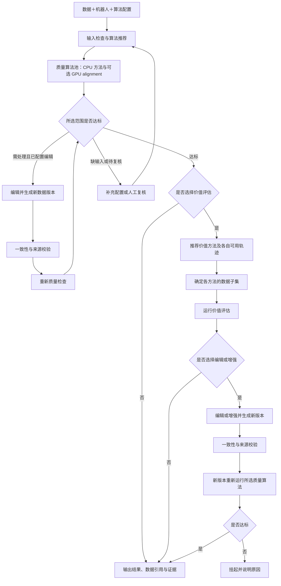

<div align="center">

# 具身数据整理框架

**Embodied Data Curation Framework（EDC）**

统一接入机器人数据，按输入条件选择算法，保留问题定位、处理版本和结果证据。

[English](README.md) · [快速开始](#快速开始) · [配置规范](docs/framework/CONFIGURATION.md) · [算法与输入](docs/framework/ALGORITHMS.md) · [协作验收](FRIEND_VALIDATION.md)

</div>


0.2.0a2：中间层姿态自动统一为 XYZW 单位四元数；支持参数化的 107 项逻辑通道词表及 IMU、里程计、手部、夹爪、触觉模板。源值审计、适用边界和迁移说明见 [姿态契约](docs/framework/ORIENTATION_HAND_TACTILE.md)。

## 最新动态

- **2026-10-31**：X1 Pro 轨迹 JSON＋MP4 格式接入 `edc batch`（`--robot x1pro_episode`），使用厂家 URDF 限位；见 [真实数据批量质检](#真实数据批量质检edc-batch)。
- **2026-10-30**：新增 `edc batch` 批量质检和单页 HTML 报告；乐聚 KUAVO（ROS1 bag，`--robot leju_kuavo`）完成配置与签名。
- **2026-10-26**：公共 Python／CLI 统一使用 `edc`；安装包为 `embodied-data-curation`，源码按六个模块组织。
- **2026-10-26**：统一总入口可引用四类配置并导出完整单文件；机器人与任务数据集独立，支持单臂／双臂范围选择。
- **2026-10-26**：算法推荐与实际执行共享绑定；编辑、增强生成新版本后经过来源校验与质量复检。验证结果与边界见 [STATUS](docs/framework/STATUS.md)。

## 核心能力

- **数据接入**：Dataset → Episode → Channel，保留任务、显式轨迹边界、源字段、selector 和时间来源。
- **算法选择**：展示完整可运行、部分可运行及不可运行的原因；默认执行前两类。部分执行不等于完整达标。
- **明确输入**：逻辑名定位信号；原值保留，已确认物理量进入 SI 执行视图。指令／反馈分别绑定。
- **有限工作流**：默认只做一轮可运行的质量检查，CPU 与 GPU alignment 同属可选质量方法；价值评估按需选择，编辑／增强生成新版本后必须复检。
- **可追溯结果**：独立评分、事件、分布及证据，不产生跨算法总分；缺输入、待复核和执行失败分别记录。
- **算法归属**：当前发布池中的算法全部由本仓库实现和登记，不依赖外部算法包、模型、私有 wheel 或 GPU 运行时。`AlgorithmSpec`／`run(context, params)` 以及 `edc.algorithms`／`edc.readers` 仍保留为后续仓库模块或明确安装的集成模块的开发接口，不会自动改变本仓库的发布算法池。

## 工作流



箭头中的返回通过有限的显式阶段及恢复执行落实，不自动循环修改数据。人工复核不覆盖原分数，不把未执行项改成通过。处理完成与最终放行分别保存在 `status` 和 `delivery_status`。

图中 GPU alignment 表示未来实现位置，当前公共包不依赖外部 GPU 算法或模型。默认运行当前可运行的质量方法；不可运行项保留原因，已执行范围之外不声称通过。价值评估通过显式添加 value 阶段选择。

## 快速开始：X1 Pro MCAP

`data-platform` 分支基于 `leju-kuavo` 的 `87c5e6f`。本例直接读取服务器上的真实 MCAP，使用内嵌图像和原始数值信号；无需先导出 JSON 或 MP4。数据不随仓库发布，许可仍未知。

需要 Python 3.10+，在本分支仓库根目录执行：

```bash
python -m venv .venv
.venv/bin/pip install -e '.[formats]'
. .venv/bin/activate
```

文档统一使用以下路径占位符。运行前，用实际值替换，并修改 `configs/datasets/x1_pro_mcap.yaml` 中的对应字段：

| 占位符 | 含义 | 配置字段 |
|---|---|---|
| `<DATASET_DIR>` | MCAP 所在的数据集目录，使用绝对路径 | `path` |
| `<MCAP_FILE>` | MCAP 文件名，包含 `.mcap` 后缀，不含目录 | `episodes[0].path` |

完整输入路径为 `<DATASET_DIR>/<MCAP_FILE>`，下方批量检查命令沿用这两个占位符。

本例配置显式登记一条 Episode（`x1_pro_reference_0001`），保留全部 32 路源通道。显式 ID 与 selector 保留；任务名称尚未确认，`tasks: []`，不会从目录名推断。

依次检查配置、查看九项输入推荐、执行并打开报告：

```bash
edc config check configs/x1_pro.yaml
edc config recommend configs/x1_pro.yaml
edc config run configs/x1_pro.yaml --output results/x1-pro-mcap
python -m http.server 8000 --directory results/x1-pro-mcap
```

浏览器打开 <http://localhost:8000/report.html>；远程服务器可通过 VS Code Remote-SSH 的“端口”面板转发 8000 端口，打开转发后的本地地址并加上 `/report.html`。保留整个结果目录，避免证据链接失效。

**单条与多条轨迹共用 batch 报告样式**：`config run`、`edc run` 和 `edc batch` 都先展示整体结论、逐条算法表与按算法归类的问题。本例只有一条轨迹，表格显示一行；点击轨迹名称展开原版逐条详情。页面沿用 `leju-kuavo` 参考样例的四项结论说明与四个主体栏目，可判定项显示通过／复核／可救／排除，缺少判定条件的项显示不适用。完整记录与证据保存在 `_runs`，由 `catalog.json` 索引。原有 `report.html` 路径不变，已有输出可运行 `edc report results/x1-pro-mcap` 更新展示，无需重跑算法。

本样例的预期结果是**生成报告，但暂不放行**：九项都有状态记录，`Action_Smoothness` 分左右臂记录，`Sync_Check` 和 `Root_Cause` 显式使用记录时间执行诊断，采集同步及设备根因不据此判定。工作流 `delivery_status: suspended`，所以 `config run` 返回退出码 **1**；这表示未满足放行条件，具体执行错误须看各项状态，不能将退出码当成九项都运行失败。当前实测与验证命令见[验收记录](docs/validation/x1_pro_mcap_20261102/README.md)。

| 配置文件 | 修改内容 |
|---|---|
| `configs/x1_pro.yaml` | 四类配置的统一入口 |
| `configs/datasets/x1_pro_mcap.yaml` | 数据位置、稳定 Episode ID、来源、未确认任务 |
| `configs/robots/x1_pro.yaml` | 双臂、32 路语义、单位、独立指令／反馈限位、复位标定及数值确认 |
| `configs/algorithms/x1_pro_mcap.yaml` | 头部帧参考、0.1 秒最大插值跨度、物理字段范围、图像检查参数 |
| `configs/workflows/x1_pro_mcap.yaml` | 显式选择九项 CPU 检查，保留缺输入项 |

主臂关节是指令，从臂是反馈；位置 rad、速度 rad/s 已确认。主臂速度与位置求导不一致的诊断保留，不以求导替代用户确认。机械臂 effort 是电流，源单位未知，不进行力矩检查。物理数值检查限定四路主／从臂的 position、velocity 与左右反馈末端 XYZ，共 10 个字段；其他数值只做有限值诊断。阈值和字段范围绑定 `data-platform-owner` 确认，修改后原确认失效，须由配置负责人核对并重新确认。

头部 RGB 每帧的 MCAP `log_time` 是本例的中间参考时间。左右反馈 XYZ 按同一文件的容器时间线性插值，仅取重叠的真实头部帧，不外推，不跨越大于 0.1 秒的源间隔；图像直接读取原帧。**设备采集时钟关系未知，容器对齐不证明采集同步**。动作平滑度、同步与归因按所选记录时间输入保留原算法的评分和判定；同步与归因配置 `timeline: {time_source: container}`，检查记录覆盖、相对时序稳定性和关联断档。设备采集同步与设备故障根因仍未评估，不能把记录时序问题直接认定为采集故障。九项均有记录不意味着九项全部通过；原始采集／容器纳秒时间、源行、插值权重均保留。

输出从 `results/x1-pro-mcap/catalog.json` 发现：`report.html` 展示结果，`_workflows/<id>/resolved-config.json` 保存工作流与生效配置，`_runs/<id>/run.json` 保存运行参数和版本，各算法目录保存 `records.jsonl`、`errors.jsonl` 与 `artifacts/`。动作插值证据在 `Action_Smoothness/artifacts/<id>/timeline.json`，同步／归因的源记录时间与行映射在各自 `artifacts/<id>/container_timeline.json`。源 MCAP 只读，输出写到独立目录。

可选导出独立配置（输出文件须尚不存在）：

```bash
edc config export configs/x1_pro.yaml --output results/x1-pro-resolved.yaml
```

## 批量检查示例（可选）

上面的快速开始已生成报告。需要通过 `edc batch` 检查一个或多个文件时，将下方路径占位符替换为实际值即可。此命令直接使用传入的文件路径，复用 `x1_pro.yaml` 机器人和 `configs/robots/x1_pro/params.json` 算法参数（与统一配置的九项参数一致）。当前目录递归发现不扫描 `.mcap`，须明确传入文件路径。

```bash
edc batch \
  '<DATASET_DIR>/<MCAP_FILE>' \
  --robot x1_pro --jobs 1 \
  --output results/x1-pro-batch.html --keep results/x1-pro-batch-runs
```

批报告为 `results/x1-pro-batch.html` 和同名 `.json`；`--keep` 保存每条数据的完整结果及证据，目标目录须尚不存在。可以传入多个明确的 MCAP 文件路径。新批次须先核对单位、硬件、标定与时间声明的适用性；本例确认不能直接证明其他采集批次适用。批入口按文件名生成 Episode ID；需要自定义稳定 ID 时使用上面的统一配置。

原有 JSON＋MP4 格式仍使用独立的 `x1pro_episode` 配置，与 MCAP 的时钟声明、复位容差不同，详见 [JSON＋MP4 配置](configs/robots/x1pro_episode.yaml)。无需真实数据的 SDK 演示仍可运行 `python examples/curation/make_example.py --output /tmp/edc-demo`，该数据明确为合成数据。

## 配置与机器人复用

```yaml
schema_version: edc_config_v1
dataset: {ref: datasets/x1_pro_mcap.yaml}
robot: {ref: robots/x1_pro.yaml}
algorithms: {ref: algorithms/x1_pro_mcap.yaml}
workflow: {ref: workflows/x1_pro_mcap.yaml}
```

| 配置 | 职责 |
|---|---|
| dataset | 位置、任务、版本、显式轨迹及批次映射 |
| robot | 型号、工程设备代号、部件、逻辑名、物理语义及适用范围 |
| algorithms | 默认执行范围、方法、输入、参数及选择规则 |
| workflow | 串行顺序、放行、子集、编辑／增强和复检 |

同一 X1 Pro 执行开抽屉和微波炉任务时，可只更换 `dataset.ref`。采集批次改变了源字段、单位或时钟时，仍须显式登记相应映射；机器人不会绑定固定目录或任务白名单。

算法默认 `arms: all`：只展开 `parts` 中 `type: arm` 的部件。独立单臂用 `main`，双臂用 `left/right`；单项可设 `arms: [left]`。声明双臂而数据缺一侧会提示部分覆盖，不能自动当成单臂完整通过。

X1 Pro 的 **32 路 topic、23 个逻辑名**合并在 [x1_pro.yaml](configs/robots/x1_pro.yaml)。六路末端 XYZ 的米制语义已登记；关节单位、共同 clock、深度比例和标定中的未知项继续阻塞对应物理检查。[单臂模板](configs/robots/single_arm.yaml)、[完整规范](docs/framework/CONFIGURATION.md)。

## CPU 质量算法

| 算法 ID | 检查内容 | 关键条件与边界 |
|---|---|---|
| Structure_Check | 文件、通道及相机配置一致性 | 按声明的所选范围检查 |
| Numeric_Check | NaN／±Inf 与已配置物理子项 | 原值有限性可运行；物理子项需语义、SI、标定与确认 |
| Action_Smoothness | 末端位置变化和平滑性 | 每条所选臂分别运行，米制反馈及有效记录时间 |
| Check_Timestamp | 各路记录节奏及有条件的跨路对齐 | 相机低频不等于缺帧；跨路另需共同 clock |
| Sync_Check | 采集同步；显式容器模式检查记录时序 | 至少两路，共同采集或记录时钟；容器模式不证明采集同步 |
| Root_Cause | 时间异常关联；显式容器模式关联记录断档 | 容器时间不能确定设备采集故障根因 |
| Dedup_Check | 原始时间／序列号重复 | 不判断图像内容，不自动删除记录 |
| Reset_Detection | 开头／结尾的关节反馈（或末端位置）与 Home 的接近情况 | 所选通道、Home、单位和容差明确；可按数据集剪辑记录只查真正的录制开头 |
| Video_Integrity | 原视频或解码画面检查 | `auto/frames/video`，记录抽样及缩放；检查对象不同不混为同一结论 |

详细最低输入、输出和默认绑定见 [算法表](docs/framework/ALGORITHMS.md)。方法、评分公式和阈值保持原有定义；选择范围和适配约束独立记录。

## 价值、编辑与增强

CPU 基础包不强制安装研究或 GPU 环境。默认 `quality_cpu` 预设保留九项 CPU 方法，仓库内的 `quality_indicators` 预设登记按模态展开的指标并按输入条件推荐；未实现或缺输入项明确挂起。真实价值方法逐项接入和验收；数据集盘点、图像亮度变换是 **SDK 接口示例**，自动生产算法池排除这些示例。

价值方法各自推荐可用轨迹，并对自己的子集运行；上游质量结果通过只读 `context.upstream` 提供。需求条件化估值、相对已有数据的互补价值和使用后实际收益属于待验证研究方向，不写成已有工程收益。

编辑／增强返回 `output / params / source_mapping`，保留原始数据，生成可回读的新版本；经过一致性与来源校验后重新检查质量。首轮变换校验仅覆盖 identity 行映射。

## 输出与使用边界

- 格式读取支持 HDF5、Parquet、MCAP、ROS1／ROS2 bag、JSON／episode、MP4 和 LeRobot，具体编码与官方依赖分别验收；可打开文件不代表全部算法适用。
- 未知单位或物理量不进入物理算法。原始时间、容器时间、播放时间、合成时间分别记录；头部相机作为参考通道不自动建立共同 clock。
- 选择轨迹和通道；任意 segment 调度、通用非 identity 变换、无限自动修复、平台账号和真实 VR 加速不在当前支持范围。
- 结果协议沿用 `dqs_record_v1`，其中 DQS 是 Data Quality Service 的缩写；公共接口统一使用 EDC。原评分、证据与历史记录保留。
- 真实数据、模型权重、私有 wheel 不随框架分发；许可未知不表示可公开分发。

## 组织结构与参与开发

```text
embodied-data-curation/
├── README.md / README.zh-CN.md
├── FRIEND_VALIDATION.md
├── pyproject.toml
├── src/edc/
│   ├── data/          # IR、读取、单位与时钟变换、LeRobot 转换
│   ├── robots/        # 机器人配置与部件范围
│   ├── algorithms/    # 注册、契约、推荐与 CPU 方法
│   ├── execution/     # CLI、执行和媒体复用
│   ├── workflows/     # 子集、放行、复核、变换校验与恢复
│   └── reporting/    # 结果与固定版式报告
├── configs/{datasets,robots,algorithms,workflows}/
├── examples/          # 数据接入、插件与完整合成工作流
├── docs/              # 使用规范、状态与证据
├── tests/edc/
└── .github/workflows/
```

当前算法池全部来自本仓库。后续仓库模块或明确安装的集成可使用 `edc.algorithms` 和 `edc.readers`，以 `team__algorithm` 命名并声明 `AlgorithmSpec`、实现 `run(context, params)`；它们不属于基础安装依赖，也不会自动进入生产推荐池。dataset 方法可声明逐轨迹条件并提供集合预检。[扩展模板](examples/plugins/algorithm)、[开发指南](docs/framework/PLUGIN_GUIDE.md)。

三人协作分为数据接入与配置体验、算法插件与输入输出、串行工作流与闭环验收三个模块，负责人、难度和交付物统一见根目录 [FRIEND_VALIDATION.md](FRIEND_VALIDATION.md)。每轮验证统一到同一个 `main` 提交，修改通过分支和 PR 合入；方法接入、许可和公开发布独立验收。
