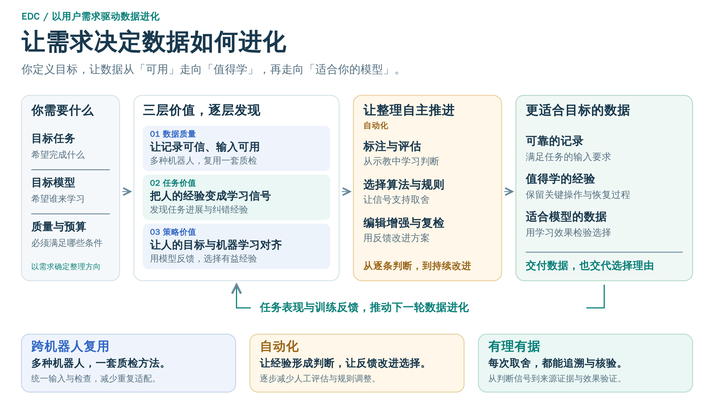

# Embodied Data Curation Framework · 具身数据整理框架

**EDC = Embodied Data Curation**。面向具身数据使用者与算法开发者的数据整理框架。

[English](README.md) · [快速开始](docs/QUICKSTART.zh-CN.md) · [数据接入](docs/DATA_AND_CONFIGURATION.zh-CN.md) · [算法指南](docs/ALGORITHMS.zh-CN.md) · [开发指南](docs/DEVELOPMENT.zh-CN.md)

## 框架概览

**让机器人数据，从“可用”走向“值得学”。** EDC 致力于发现具身数据的潜力，为目标任务和策略模型整理可靠、有价值的数据。



**用户需求**包括任务与成功条件、目标策略、质量要求和数据／计算预算，适用时提供专家示教或可靠参考数据。当前可获得质检报告、问题证据、筛选数据副本或软链接及来源清单；后续将扩展到任务标注和适合目标策略的数据及改进版本。[需求与交付](docs/QUALITY_VALIDATION.zh-CN.md#needs)

- **数据质量｜多种机器人，一套质检方法。** 让不同机器人的数据可被机器正确读取与解释，让质量检查跨设备复用。
- **任务价值｜把人类理解，变成机器的学习信号。** 从专家示范和任务要求中，提炼值得学习的关键动作与纠错经验。
- **策略价值｜让人的目标，与机器的学习在反馈中对齐。** 以目标与参考经验为依据，用模型训练反馈判断哪些数据有助于学习，减少反复真机筛选评估。

在三个层次之上，框架进一步追求两项优势：

- **自动化｜让经验形成判断，让反馈改进选择。** 从专家示教中学习评估依据，用数据与训练反馈支持筛选决策，逐步减少人工评估、规则调整和方法选择。[机制与论文依据](docs/QUALITY_VALIDATION.zh-CN.md#automation)
- **有理有据｜每次取舍，都能追溯依据、检验效果。** 将选择关联到质量证据、任务进展与模型学习信号，记录处理过程，并用独立反馈验证选择。[如何核验选择](docs/QUALITY_VALIDATION.zh-CN.md#evidence)

> 当前提供数据质量检查；任务价值和策略价值已有研究基础，相关方法将逐步接入框架。

> **长期目标：你提出目标，框架持续自主探索——什么数据值得留，什么经验值得学，下一步该如何改进。**

三个层次、研究支撑与验证安排见[从质量检查到自主数据整理](docs/QUALITY_VALIDATION.zh-CN.md) · [演示文稿](docs/presentations/edc-framework.zh-CN.pptx)。读取器覆盖 LeRobot、HDF5、Parquet、ROS bag、MCAP 等，具体条件见[支持范围](docs/DATA_AND_CONFIGURATION.zh-CN.md#formats)。

## 最新动态

> 🚀 我们即将发布 Embodied Data Curation Framework 仓库，敬请期待！

## 架构与模块关系


- **数据使用者**：提供数据与机器人配置 → 查看推荐并选择算法 → 运行、查看报告及导出数据。
- **算法开发者**：编写算法并声明输入输出 → 注册与验证 → 接入同一套推荐和执行流程。

两类入口共用输入预检、执行与结果记录。[模块和扩展说明](docs/DEVELOPMENT.zh-CN.md#interfaces)

## 安装与快速开始

需要 Python 3.10 或以上。在仓库源码中执行，将 `/path/to/...` 替换为本机路径。

**1. 安装**

```bash
cd /path/to/embodied-data-curation
python -m venv .venv
source .venv/bin/activate
pip install '.[formats]'
```

**2. 准备数据**

准备一份与 [`x1pro_mcap.yaml`](configs/robots/x1pro_mcap.yaml) 匹配的 X1 Pro 双臂机器人真实 MCAP，放到 `/path/to/dataset/episode.mcap`。[数据说明与获取边界](docs/QUICKSTART.zh-CN.md#data)

**3. 运行并查看结果**

```bash
edc batch /path/to/dataset/episode.mcap \
  --robot configs/robots/x1pro_mcap.yaml \
  --output /path/to/results/report.html --jobs 1
```

用浏览器打开 `/path/to/results/report.html`；同目录保存 `report.json`。运行成功不表示数据全部通过。[完整快速开始](docs/QUICKSTART.zh-CN.md)

**4. 导出选中数据（可选）**

根据 batch 的 `report.json`，默认只导出“建议保留”（`keep`）的数据，任选一种方式：

```bash
# 复制数据
edc regenerate /path/to/results/report.json --output /path/to/selected --mode copy

# 或创建指向原数据的软链接
edc regenerate /path/to/results/report.json --output /path/to/selected-links --mode link
```

输出包含数据副本或链接及来源清单 `manifest.json`。原始数据不变；软链接依赖原数据持续存在。[筛选导出与限制](docs/SELECTION.md)

## 数据与配置

数据集说明文件位置、采集任务，以及每次操作从哪里开始和结束；机器人配置定义字段含义；算法参数定义本次检查范围和判定条件。

**机器人配置说明有哪些臂，算法配置说明本次检查哪些臂。** `arms: all` 检查全部已声明的臂，`[left]`／`[right]` 选择单侧，独立单臂可声明为 `main`。同一机器人配置可用于多个任务。

| 需要做什么 | 文档入口 |
|---|---|
| 查看数据字段、选择格式、说明每次操作的起止位置 | [数据集接入](docs/DATA_AND_CONFIGURATION.zh-CN.md#dataset) |
| 编写机器人 YAML、映射源字段与单／双臂 | [机器人配置](docs/DATA_AND_CONFIGURATION.zh-CN.md#robot) |
| 确认源单位、时间来源及 clock | [单位与时间](docs/DATA_AND_CONFIGURATION.zh-CN.md#units-time) |
| 使用 URDF 获取关节信息并核对配置 | [URDF 使用与限制](docs/DATA_AND_CONFIGURATION.zh-CN.md#urdf) |
| 配置算法输入、范围和参数 | [算法配置](docs/ALGORITHMS.zh-CN.md#selection) |

未知单位可保留并检查 NaN／Inf，但不能据此进行需要已知单位的物理计算。

## 算法推荐与执行

推荐说明哪些算法**完整可运行、部分可运行或不可运行**，并列出可检查范围与缺失条件；是否通过由执行结果判断。

```bash
# 查看数据相关的推荐：此脚本调用 edc.recommend()
python examples/quickstart/recommend.py /path/to/dataset/episode.mcap \
  --robot configs/robots/x1pro_mcap.yaml

# 选择算法；按给定顺序执行
edc run /path/to/dataset/episode.mcap \
  --robot configs/robots/x1pro_mcap.yaml \
  --algorithm Structure_Check --algorithm Numeric_Check \
  --output /path/to/results/selected
```

`run` 保留指定顺序；未选择算法时尝试完整及部分可运行的质量项，并记录缺失条件。`batch` 对单条、多条或目录运行质量集合；`edc algorithms` 仅列登记清单。[选择规则与 Python API](docs/ALGORITHMS.zh-CN.md#selection)

上例生成 `/path/to/results/selected/report.html`，与 batch 使用相同四栏布局；`--no-html` 可关闭单次 HTML，JSON 和证据仍保留。batch 只生成一份汇总 HTML，其 `report.json` 用于筛选导出；`--keep` 可保留各条完整结果。[报告与证据](docs/ALGORITHMS.zh-CN.md#results)

| 算法名称 | 检查内容 | 最低输入 | 详细文档 |
|---|---|---|---|
| `Structure_Check` | 通道、相机与时长 | 通道目录及结构要求 | [结构检查](docs/ALGORITHMS.zh-CN.md#structure-check) |
| `Numeric_Check` | 有限值及已配置的物理约束 | 数值字段；物理项另需单位及阈值 | [数值检查](docs/ALGORITHMS.zh-CN.md#numeric-check) |
| `Action_Smoothness` | 保持段末端振动与读数冻结 | 末端 XYZ 反馈及可用时间轴 | [动作平滑度](docs/ALGORITHMS.zh-CN.md#action-smoothness) |
| `Check_Timestamp` | 时间间隔、配对及断档 | 有效且单位明确的时间轴 | [时间戳检查](docs/ALGORITHMS.zh-CN.md#check-timestamp) |
| `Sync_Check` | 各路起止覆盖及录包与采集时间差 | 独立采集时间及可比较的 clock；时间差另需录包时间 | [采集同步](docs/ALGORITHMS.zh-CN.md#sync-check) |
| `Root_Cause` | 多路时间异常关联 | 可比较的多路时间及来源分组 | [时间异常归因](docs/ALGORITHMS.zh-CN.md#root-cause) |
| `Dedup_Check` | 时间戳或序号重复 | 原始时间值或序列信息 | [重复检查](docs/ALGORITHMS.zh-CN.md#dedup-check) |
| `Reset_Detection` | 开头、结尾与 Home 的距离 | 反馈位置、Home 及容差 | [复位检测](docs/ALGORITHMS.zh-CN.md#reset-detection) |
| `Video_Integrity` | 图像内容与视频完整性 | 可解码图像帧或视频 | [图像／视频检查](docs/ALGORITHMS.zh-CN.md#video-integrity) |

每项保留自身指标与证据，不生成跨算法总分。[检查依据与研究路线](docs/QUALITY_VALIDATION.zh-CN.md)

## 开发者与组织结构

质量算法可继承 `QualityAlgorithm`、返回 `Item` 列表，由 `AlgorithmResult` 汇总；通用插件使用 `AlgorithmSpec + run(context, params)`，注册后进入同一套预检与执行流程。

[输出基类与接入新算法](docs/DEVELOPMENT.zh-CN.md#quality-example) · [读取器插件](docs/DEVELOPMENT.zh-CN.md#readers) · [贡献指南](CONTRIBUTING.md)

```text
src/edc/
├── data/          # 数据接口、读取器与变换
├── robots/        # 配置编译、部件与通道语义
├── algorithms/    # 注册、预检、九项质量算法与输出基类
├── execution/     # CLI、单次与批量执行
├── workflows/     # 可选阶段编排与复检接口
└── reporting/     # 报告与证据展示
configs/
├── robots/        # 机器人 YAML 与配套 URDF
└── templates/     # 单臂、双臂等配置模板
examples/          # 使用与插件示例
docs/              # 专题文档
tests/             # 契约与实现测试
```

### 待办

以下均为待接入或研究方向，具体方法与依据见[质量专题](docs/QUALITY_VALIDATION.zh-CN.md#layers)：

1. 任务分段、进度判断与有效片段发现：STEAM、MGT-QV。
2. 按任务准则自动标注与多模态核验：参考 FLORA 等研究。
3. 数据编辑、演示重采样与变换后质量复检：DemoTempo 等方向。
4. 面向目标策略的数据选择：RoboDrop、VLA as a judge。
5. 根据反馈调整规则与算法组合，探索新算法生成、验证及接入，走向[自主数据整理](docs/QUALITY_VALIDATION.zh-CN.md#autonomous)。
