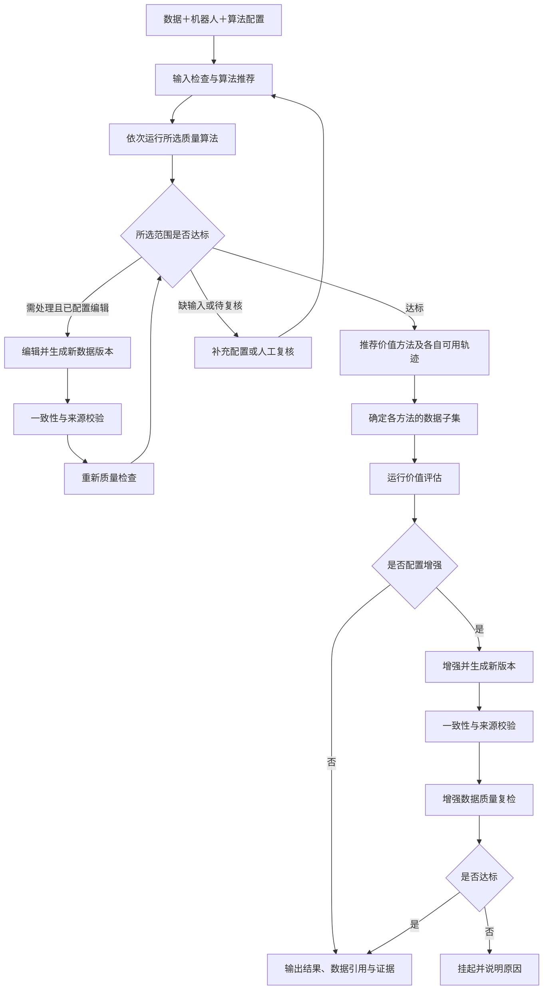

<div align="center">

# 具身数据整理框架

**Embodied Data Curation Framework（EDC）**

统一接入机器人数据，按输入条件选择算法，保留问题定位、处理版本和结果证据。

[English](README.md) · [快速开始](#快速开始) · [配置规范](docs/framework/CONFIGURATION.md) · [算法与输入](docs/framework/ALGORITHMS.md) · [协作验收](FRIEND_VALIDATION.md)

</div>

## 最新动态

- **2026-10-26**：公共 Python／CLI 统一使用 `edc`；安装包为 `embodied-data-curation`，源码按六个模块组织。
- **2026-10-26**：统一总入口可引用四类配置并导出完整单文件；机器人与任务数据集独立，支持单臂／双臂范围选择。
- **2026-10-26**：算法推荐与实际执行共享绑定；编辑、增强生成新版本后经过来源校验与质量复检。验证结果与边界见 [STATUS](docs/framework/STATUS.md)。

## 核心能力

- **数据接入**：Dataset → Episode → Channel，保留任务、显式轨迹边界、源字段、selector 和时间来源。
- **算法选择**：展示完整可运行、部分可运行及不可运行的原因；默认执行前两类。部分执行不等于完整达标。
- **明确输入**：逻辑名定位信号；原值保留，已确认物理量进入 SI 执行视图。指令／反馈分别绑定。
- **有限工作流**：质量 → 价值方法与子集 → 价值评估 → 可选增强 → 质量复检。编辑副本也必须复检。
- **可追溯结果**：独立评分、事件、分布及证据，不产生跨算法总分；缺输入、待复核和执行失败分别记录。
- **插件开发**：算法声明条件并实现 `run(context, params)`；安装插件后发现，无需修改核心分发表。

## 工作流



箭头中的返回通过有限的显式阶段及恢复执行落实，不自动循环修改数据。人工复核不覆盖原分数，不把未执行项改成通过。处理完成与最终放行分别保存在 `status` 和 `delivery_status`。

## 快速开始

Python ≥ 3.10。基础依赖仅 NumPy／PyYAML，格式与图像检查依赖单独安装；本仓库仍是私有开发交付，公开发布与许可核查见 [发布清单](docs/RELEASE_CHECKLIST.md)。

```bash
pip install -e '.[formats,test]'
pip install -e examples/plugins/algorithm

# 明确标注的合成接口例程，不是真实任务或估值效果验证
python examples/curation/make_example.py --output /tmp/edc-demo
edc config check /tmp/edc-demo/curation.yaml
edc config recommend /tmp/edc-demo/curation.yaml
edc config export /tmp/edc-demo/curation.yaml --output /tmp/edc-complete.yaml
edc config run /tmp/edc-complete.yaml --output /tmp/edc-results
edc config run /tmp/edc-complete.yaml --output /tmp/edc-results --resume
```

目录必须使用自己的全新路径。结果入口为 `/tmp/edc-results/catalog.json` 和 `report.html`；工作流页面位于 `_workflows/<id>/report.html`，逐算法证据位于 `_runs/<id>`。

Python 使用相同配置和执行器：

```python
from edc import load_config, recommend_config, run_workflow

configuration = load_config("curation.yaml")
pool = recommend_config(configuration)
result = run_workflow(configuration, output="results")
print(result["delivery_status"], result["outputs"], result["pending"])
```

## 配置与机器人复用

```yaml
schema_version: edc_config_v1
dataset: {ref: datasets/microwave.yaml}
robot: {ref: robots/x1_pro.yaml}
algorithms: {ref: algorithms/quality.yaml}
workflow: {ref: workflows/curation.yaml}
```

| 配置 | 职责 |
|---|---|
| dataset | 位置、任务、版本、显式轨迹及批次映射 |
| robot | 型号、工程设备代号、部件、逻辑名、物理语义及适用范围 |
| algorithms | 默认执行范围、方法、输入、参数及选择规则 |
| workflow | 串行顺序、放行、子集、编辑／增强和复检 |

同一 X1 Pro 执行开抽屉和微波炉任务时，可只更换 `dataset.ref`。采集批次改变了源字段、单位或时钟时，仍须显式登记相应映射；机器人不会绑定固定目录或任务白名单。

算法默认 `arms: all`：只展开 `parts` 中 `type: arm` 的部件。独立单臂用 `main`，双臂用 `left/right`；单项可设 `arms: [left]`。声明双臂而数据缺一侧会提示部分覆盖，不能自动当成单臂完整通过。

X1 Pro 的 **32 路 topic、23 个逻辑名**合并在 [x1_pro.yaml](configs/robots/x1_pro.yaml)。六路末端 XYZ 的米制语义已登记；关节单位、共同 clock、深度比例和标定中的未知项继续阻塞对应物理检查。[单臂模板](configs/robots/single_arm.yaml)、[完整规范](docs/framework/CONFIGURATION.md)。

## CPU 质量算法

| 算法 ID | 检查内容 | 关键条件与边界 |
|---|---|---|
| Structure_Check | 文件、通道及相机配置一致性 | 按声明的所选范围检查 |
| Numeric_Check | NaN／±Inf 与已配置物理子项 | 原值有限性可运行；物理子项需语义、SI、标定与确认 |
| Action_Smoothness | 末端位置变化和平滑性 | 每条所选臂分别运行，米制反馈及有效记录时间 |
| Check_Timestamp | 各路记录节奏及有条件的跨路对齐 | 相机低频不等于缺帧；跨路另需共同 clock |
| Sync_Check | 独立采集时间轴之间的同步 | 至少两路及共同时钟或验证过的映射 |
| Root_Cause | 时间异常关联和来源归因 | 不能从合成公共行时间推断采集根因 |
| Dedup_Check | 原始时间／序列号重复 | 不判断图像内容，不自动删除记录 |
| Reset_Detection | 关节反馈与 Home 的接近情况 | 所选关节、Home、单位和容差明确 |
| Video_Integrity | 原视频或解码画面检查 | `auto/frames/video`，记录抽样及缩放；检查对象不同不混为同一结论 |

详细最低输入、输出和默认绑定见 [算法表](docs/framework/ALGORITHMS.md)。方法、评分公式和阈值保持原有定义；选择范围和适配约束独立记录。

## 价值、编辑与增强

CPU 基础包不强制安装研究或 GPU 环境。真实价值方法逐项接入和验收；数据集盘点、图像亮度变换是 **SDK 接口示例**，自动生产算法池排除这些示例。

价值方法各自推荐可用轨迹，并对自己的子集运行；上游质量结果通过只读 `context.upstream` 提供。需求条件化估值、相对已有数据的互补价值和使用后实际收益属于待验证研究方向，不写成已有工程收益。

编辑／增强返回 `output / params / source_mapping`，保留原始数据，生成可回读的新版本；经过一致性与来源校验后重新检查质量。首轮变换校验仅覆盖 identity 行映射。

## 输出与使用边界

- 格式读取支持 HDF5、Parquet、MCAP、ROS1／ROS2 bag、JSON／episode、MP4 和 LeRobot，具体编码与官方依赖分别验收；可打开文件不代表全部算法适用。
- 未知单位或物理量不进入物理算法。原始时间、容器时间、播放时间、合成时间分别记录；头部相机作为参考通道不自动建立共同 clock。
- 选择轨迹和通道；任意 segment 调度、通用非 identity 变换、无限自动修复、平台账号和真实 VR 加速不在当前支持范围。
- 结果协议沿用 `dqs_record_v1`，其中 DQS 是 Data Quality Service 的缩写；公共接口统一使用 EDC。原评分、证据与历史记录保留。
- 真实数据、模型权重、私有 wheel 不随框架分发；许可未知不表示可公开分发。

## 组织结构与参与开发

```text
embodied-data-curation/
├── README.md / README.zh-CN.md
├── FRIEND_VALIDATION.md
├── pyproject.toml
├── src/edc/
│   ├── data/          # IR、读取、单位与时钟变换、LeRobot 转换
│   ├── robots/        # 机器人配置与部件范围
│   ├── algorithms/    # 注册、契约、推荐与 CPU 方法
│   ├── execution/     # CLI、执行和媒体复用
│   ├── workflows/     # 子集、放行、复核、变换校验与恢复
│   └── reporting/    # 结果与固定版式报告
├── configs/{datasets,robots,algorithms,workflows}/
├── examples/          # 数据接入、插件与完整合成工作流
├── docs/              # 使用规范、状态与证据
├── tests/edc/
└── .github/workflows/
```

算法插件使用 `edc.algorithms`，读取器插件使用 `edc.readers`；外部 ID 使用 `team__algorithm`。声明 `AlgorithmSpec`，实现 `run(context, params)`，并验证单位、时间、左右与失败隔离；dataset 方法可声明逐轨迹条件并提供集合预检。[插件模板](examples/plugins/algorithm)、[开发指南](docs/framework/PLUGIN_GUIDE.md)。

朋友可从独立安装、配置体验、范围绑定、插件、工作流回路、恢复执行与报告检查入手，任务和提交证据统一列在根目录 [FRIEND_VALIDATION.md](FRIEND_VALIDATION.md)。贡献通过分支和 PR 提交；方法接入、许可和公开发布独立验收。
