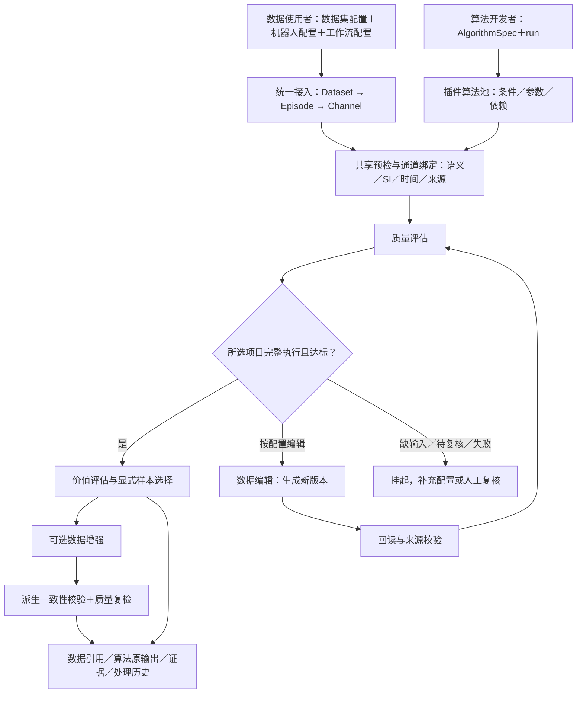

# Embodied Data Curation Framework

**具身数据整理框架：统一接入数据，按条件选择算法，保留检测证据和每一步数据来源。**

面向具身数据使用者与算法开发者，支持质量评估、价值评估、数据编辑及数据增强的插件工作流。
当前交付公共核心与 **9 项 CPU 质量算法**；价值、编辑、增强通过可安装示例验证接口，真实研究方法后续逐项接入。

[English](README.md) · [工作流教程](docs/framework/WORKFLOWS.md) · [开发贡献](CONTRIBUTING.md) · [验收状态](docs/framework/STATUS.md)

## 最新进展与计划

- **已实现**：Dataset → Episode → Channel 接入、逻辑通道名、SI 执行视图、算法池与共享预检、固定版式报告。
- **已实现**：有限阶段工作流、集合交接、编辑／增强输出回读校验、人工复核、内容与版本匹配的恢复执行。
- **本轮验证**：合成 HDF5 的质量 → 编辑与复检 → 集合盘点 → 增强与复检；MCAP 显式时钟映射被三项时间算法消费。验证数字与范围见 [STATUS](docs/framework/STATUS.md)。
- **后续**：真实价值方法、编辑方法和增强方法分别验收；完成许可核查后再考虑公开发布。本库当前是私有协作交付，不表示已获得开源分发许可。

兼容原 `embodied-dqs` 包及 `dqs` Python／CLI 入口；`dqs` 沿用 Data Quality Service 的缩写，现作为整个数据整理框架的公共入口。

## 架构



图中的回路由配置中的有限阶段实现，不自动反复修复。数据编辑与质量、价值、增强是不同业务模块；默认主顺序为 **质量 → 价值 → 可选增强**。增强后默认只做一致性与所选质量复检，不自动再次估值。

## 快速开始

Python ≥3.10。基础安装仅依赖 NumPy、PyYAML；格式读取、图像与科学计算按需安装。原数据保持只读，输出目录应放在源数据之外。

```bash
python -m venv .venv
source .venv/bin/activate
pip install -e '.[formats]'

dqs demo fetch synthetic --output /tmp/curation-demo
dqs inspect /tmp/curation-demo
dqs recommend /tmp/curation-demo
dqs run /tmp/curation-demo --algorithm Numeric_Check --output /tmp/curation-results
dqs report /tmp/curation-results
```

该示例是合成接口数据，刻意保留待确认项；不应把“执行完成”解释为“所有质量项合格”。

体验全部阶段：

```bash
pip install -e examples/plugins/algorithm
python examples/workflows/make_example.py --output /tmp/curation-workflow
dqs workflow check /tmp/curation-workflow/workflow.yaml
dqs workflow run /tmp/curation-workflow/workflow.yaml --output /tmp/curation-chain
dqs workflow run /tmp/curation-workflow/workflow.yaml --output /tmp/curation-chain --resume
```

产生 2 条源轨迹、2 条编辑轨迹、4 条增强轨迹。价值示例仅盘点集合，编辑／增强示例仅改变合成图像亮度，**没有验证真实估值、修复效果或训练收益**。

## 数据使用者如何配置

| 配置 | 负责内容 | 示例／说明 |
|---|---|---|
| 数据集 `dataset.yaml` | 位置、版本、任务、显式轨迹 ID 与 selector | [数据模型](docs/framework/DATA_MODEL.md) |
| 机器人 `robot.yaml` | 型号／实例、原 topic→逻辑名、部位、物理量、源单位、指令／反馈、坐标系、时间与确认状态 | [接入教程](docs/framework/ONBOARDING.md) |
| 工作流 `workflow.yaml` | 阶段、算法、channels、参数、子集、放行 | [完整示例](examples/workflows/make_example.py) |

```yaml
# robot.yaml 的 channels 片段；仅填写自己已确认的信息
channels:
  /right_arm/end_pose:
    logical_name: pose/arm/right/feedback
    modality: pose
    fields: [position]
    side: right
    source_kind: feedback
    unit: m
    coordinate_frame: right_arm_neutral
    representation: {quantity: position, semantic_status: confirmed}
    time_source: acquisition
    clock: robot_clock
```

算法参数使用 `channels: [pose/arm/right/feedback]` 绑定到源 topic；平滑度当前一次选择一路，左臂、右臂可以分别调用。名称不代替语义和单位确认，也不允许两个不同信号占用一个逻辑名。

已确认源单位在执行时转换为 SI，存储原值不变；未知单位仍可做原值有限性检查，依赖物理意义的算法被阻塞。`--unit-policy manual` 禁止自动换算，此时调用者必须提供并声明 SI 输入。

时间来源区分采集、容器、播放、合成和未知。单路保留原频率；跨路需要共同 clock 或显式映射。`target_clock` 仅调用机器人配置里的仿射映射，不重采样，也不因选了头部相机就证明硬件共时钟。详见 [时间与 SI](docs/framework/READING_UNITS_AND_TIME.md)、[变换](docs/framework/TRANSFORMS.md)。

## CPU 质量算法

方法、原评分公式与阈值沿用迁移基线，不跨算法汇总成一个分数。全部算法支持 `channels` 配置；具体可执行性由当前数据和参数共同决定。

| 算法 ID | 用途／最低输入 | 输出及边界 |
|---|---|---|
| `Structure_Check` | 文件与通道清单；相机要求需配置 | 结构、缺失和相机通道配置一致性；未配置的要求不能冒充已验收 |
| `Numeric_Check` | 可读取数值字段；物理项需语义、SI、标定与作者确认 | NaN/Inf 位置与已配置的物理子项；有限值通过不等于物理项全部通过 |
| `Action_Smoothness` | 一路实际末端 XYZ 反馈、m、有效记录时间 | 原平滑度与冲击／停滞结果；缺少可评估静止段保持未完整评估 |
| `Check_Timestamp` | 单路单位明确的记录时间；跨路评分另需独立时间、共同 clock 和相机参考 | 单路节奏及跨路对齐；不以低频相机帧数认定高频关节缺帧 |
| `Sync_Check` | 至少两路独立采集时间、s、共同 clock | 时间覆盖、对齐和稳定性；公共行时间不能证明采集同步 |
| `Root_Cause` | 至少两路可比较的独立记录时间、共同 clock | 时间异常关联与归因线索；不推断硬件故障事实 |
| `Dedup_Check` | 原始记录时间值，可附序号 | 时间重复段和额外重复计数；不检查图像内容，不自动删除 |
| `Reset_Detection` | 关节 position、确认的 Home 参考／单位／容差 | 所选关节复位偏差；缺标定返回待标定 |
| `Video_Integrity` | 可解码 RGB 帧或原视频 | 画面异常和复核线索；视频入口另有容器检查，检查对象、抽样和缩小比例均记录 |

图像算法参数 `input_mode: auto|frames|video` 由使用者在工作流算法参数中配置；开发者提供两种输入适配。`auto` 按原生存储选择；`frames` 不生成 MP4，容器子项不适用；`video` 检查原视频或明确标注的派生视频。原始编码证据与派生像素检查不能互相替代。

## 读取范围与结果

读取器覆盖原生 HDF5、Parquet、MCAP、ROS bag、JSON/episode、MP4 及 LeRobot。**读取器存在不等于任意机器人已通过完整支持验收**：字段、编码、轨迹边界和语义均需验证。LeRobot v3 在官方可选依赖可用时默认官方读取；旧格式／兼容后端可显式选择，转换范围见 [LeRobot](docs/framework/LEROBOT.md)。

```text
results/
├── catalog.json                所有运行与工作流的发现入口
├── report.html                 固定版式算法结果与证据
├── reviews.jsonl               追加式人工复核（发生复核时生成）
├── _runs/<run_id>/              配置、版本、原结果、错误、证据、历史筛选
└── _workflows/<workflow_run>/   阶段、数据引用、放行、样本选择、工作流报告
```

`dqs_record_v1` 分开记录处理状态和数据判断：缺输入、缺依赖、执行失败均不能变成质量通过。自动满分与待复核线索可以并存；人工确认／驳回记录到单独文件，不覆盖评分，不能补成未执行项。详见 [放行与复核](docs/framework/WORKFLOWS.md)。

## 算法开发者与协作

使用 `AlgorithmSpec` 声明类别、粒度、参数、输入、SI 单位、语义、时间与依赖；实现 `run(context, params)`。通过 `dqs.algorithms` 安装注册，新格式通过 `dqs.readers` 注册，不修改核心分发表。

- [算法模板](examples/plugins/algorithm) 包含质量、dataset 盘点、编辑和增强示例；[读取器模板](examples/plugins/reader) 展示格式接入。
- `context.upstream` 提供只读上游 run、数据引用、原结果与放行；dataset 粒度对当前集合调用一次，首轮没有 segment 调度。
- 变换返回 `output / params / source_mapping`。v1 验证器限定逐行 identity 映射与不变的数据形状、语义；重采样、裁剪、改维等方法需扩展契约后单独验收。
- [贡献指南](CONTRIBUTING.md)、[可并行分工](docs/framework/CONTRIBUTOR_TASKS.md)、[建设计划](docs/framework/BUILD_PLAN.md)。

```text
embodied-data-curation/
├── dqs/                       公共薄入口，保持兼容
├── framework/
│   ├── ir/                    Dataset／Episode／Channel 与 SI 执行视图
│   ├── readers/               读取器
│   ├── robots/                机器人与通道配置
│   ├── transforms/            单位、时钟、坐标、显式重采样工具
│   ├── conversion/            LeRobot 转换
│   └── workflows/             编排、交接、复核、放行与恢复
├── Quality_Assessment/        9 项 CPU 方法及适配
├── examples/                  配置、工作流、独立安装的插件
├── tests/dqs/                 契约、边界、失败隔离及回归
├── docs/                      使用、验收、迁移与来源
└── .github/workflows/         测试与独立 wheel 安装
```

新库作为迁出核心与 CPU 方法的维护源；原研究仓库保留未迁方法、GPU 环境和历史结果。迁移清单按**当前工作区快照**建立，包含必要的原未跟踪文件，不仅依赖旧 Git HEAD。

## 许可与发布边界

本轮不携带真实数据、模型权重、私有 wheel、第三方子模块或历史实验输出。源码、算法、依赖、模型和真实样例需分别核查来源与许可；当前仓库级分发许可尚未确认，不能按 MIT／Apache 对外宣称已开源。见 [来源与许可清单](docs/RELEASE_CHECKLIST.md)。
