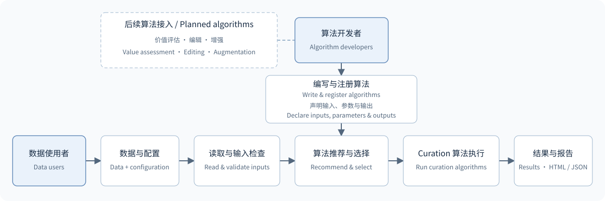

# Embodied Data Curation Framework · 具身数据整理框架

**EDC = Embodied Data Curation**。面向具身数据使用者与算法开发者，提供统一数据接入、按数据推荐算法及可追溯的具身数据检查结果。

[English](README.md) · [快速开始](docs/QUICKSTART.zh-CN.md) · [数据接入](docs/DATA_AND_CONFIGURATION.zh-CN.md) · [算法指南](docs/ALGORITHMS.zh-CN.md) · [开发指南](docs/DEVELOPMENT.zh-CN.md)

## 框架概览

把具身智能数据与机器人配置交给 EDC 并选择适用的算法，就能获得**可追溯问题的数据检查报告**！

| 能力 | 当前支持 |
|---|---|
| 数据接入 | 读取每次机器人操作中的关节、相机等数据，发现问题时能定位到对应的操作记录和原始文件 |
| 机器人语义 | 配置源字段、逻辑名、部件、单位及指令／反馈；支持单臂与双臂 |
| 算法选择 | 根据输入、参数、单位、时间和依赖，说明完整、部分及不可运行项 |
| 质量检查 | 检查结构、数值、保持段振动、时间、复位与图像／视频 |
| 结果追溯 | HTML 定位问题；JSON 保存检查项、指标、证据及实际输入 |
| 筛选导出 | 根据 batch 报告选择建议保留的数据，复制或创建软链接，并保存原始数据与输出数据的对应清单 |

读取器覆盖 LeRobot、HDF5、Parquet、ROS bag、MCAP等；具体后端、消息类型见[支持范围](docs/DATA_AND_CONFIGURATION.zh-CN.md#formats)。

## 最新动态

> 🚀 我们即将发布 Embodied Data Curation Framework 仓库，敬请期待！

## 架构与模块关系



使用者提供数据与机器人配置；开发者通过注册接口接入算法。两者共用输入预检、执行与结果记录。[模块和扩展说明](docs/DEVELOPMENT.zh-CN.md#interfaces)

## 安装与快速开始

需要 Python 3.10 或以上。以下命令在已取得的仓库源码中执行；将 `/path/to/...` 替换为本机路径。

**1. 安装**

```bash
cd /path/to/embodied-data-curation
python -m venv .venv
source .venv/bin/activate
pip install '.[formats]'
```

**2. 准备数据**

本例使用一份 X1 Pro 双臂机器人的真实 MCAP，配套配置为 [`x1pro_mcap.yaml`](configs/robots/x1pro_mcap.yaml)。将数据放到 `/path/to/dataset/episode.mcap`；文件与配置须匹配。[数据说明与获取边界](docs/QUICKSTART.zh-CN.md#data)

**3. 运行并查看结果**

```bash
edc batch /path/to/dataset/episode.mcap \
  --robot configs/robots/x1pro_mcap.yaml \
  --output /path/to/results/report.html --jobs 1
```

用浏览器打开 `report.html`，同目录的 `report.json` 供程序读取。运行成功表示检查已执行，不表示所有数据都通过。[完整快速开始与参考结果](docs/QUICKSTART.zh-CN.md)

**4. 导出选中数据（可选）**

根据 batch 的 `report.json`，默认只导出“建议保留”（`keep`）的数据。按需要选择一种方式：

```bash
# 复制数据
edc regenerate /path/to/results/report.json --output /path/to/selected --mode copy

# 或创建指向原数据的软链接
edc regenerate /path/to/results/report.json --output /path/to/selected-links --mode link
```

输出目录保存数据副本或链接，以及记录来源和筛选条件的 `manifest.json`。原始数据保持不变；软链接依赖原数据持续存在。共享文件中只选部分轨迹的限制见[筛选导出说明](docs/SELECTION.md)。

## 数据与配置

数据集说明文件位置、采集任务，以及每次操作从哪里开始和结束；机器人配置定义字段含义；算法参数定义本次检查范围和判定条件。

**机器人配置说明有哪些臂，算法配置说明本次检查哪些臂。** `arms: all` 检查全部已声明的臂；双臂可选 `[left]` 或 `[right]`，独立单臂可声明为 `main`。同一机器人配置可用于多个任务数据集。

| 需要做什么 | 文档入口 |
|---|---|
| 查看数据字段、选择格式、说明每次操作的起止位置 | [数据集接入](docs/DATA_AND_CONFIGURATION.zh-CN.md#dataset) |
| 编写机器人 YAML、映射源字段与单／双臂 | [机器人配置](docs/DATA_AND_CONFIGURATION.zh-CN.md#robot) |
| 确认源单位、时间来源及 clock | [单位与时间](docs/DATA_AND_CONFIGURATION.zh-CN.md#units-time) |
| 使用 URDF 获取关节信息并核对配置 | [URDF 使用与限制](docs/DATA_AND_CONFIGURATION.zh-CN.md#urdf) |
| 配置算法输入、范围和参数 | [算法配置](docs/ALGORITHMS.zh-CN.md#selection) |

未知单位可在支持的字段中保留，但依赖该物理量的计算不能据此推荐为完整可运行。原值有限性检查与物理阈值检查分别说明。

## 算法推荐与执行

推荐检查算法的输入条件，不替代质量判断。**完整可运行**表示预检条件满足；**部分可运行**表示只能检查明确子集；**不可运行**会列出缺失输入、单位、时间或依赖。

```bash
# 查看数据相关的推荐：此脚本调用 edc.recommend()
python examples/quickstart/recommend.py /path/to/dataset/episode.mcap \
  --robot configs/robots/x1pro_mcap.yaml

# 选择算法；按给定顺序执行
edc run /path/to/dataset/episode.mcap \
  --robot configs/robots/x1pro_mcap.yaml \
  --algorithm Structure_Check --algorithm Numeric_Check \
  --output /path/to/results/selected
```

未显式选择时尝试完整及部分可运行的质量项，缺失条件保留原因。`batch` 运行已登记的质量集合；逐项选择使用 `run` 或 Python API。`edc algorithms` 仅列登记清单。[选择规则、Python 示例与批量运行](docs/ALGORITHMS.zh-CN.md#selection)

`run` 默认在输出目录生成 `report.html`，使用与 `batch` 相同的四栏报告，仅展示本次选中的算法。上例打开 `/path/to/results/selected/report.html`；完整 JSON 和证据保存在 `_runs/<run_id>/`，由 `catalog.json` 定位。每次运行的报告也保存在对应运行目录中。添加 `--no-html` 可关闭本次 HTML 生成，JSON 和证据照常保存；Python API 使用 `edc.run(..., html_report=False)`。

`batch` 支持单条、多条和目录输入，自动关闭内部 `run` 的 HTML，只生成一份汇总报告；即使使用 `--keep`，也只保留各条数据的 JSON 和证据，不额外生成单条 HTML。其 `report.json` 可用于上述筛选导出。

| 算法名称 | 检查内容 | 最低输入 | 详细文档 |
|---|---|---|---|
| `Structure_Check` | 通道、相机与时长 | 通道目录及结构要求 | [结构检查](docs/ALGORITHMS.zh-CN.md#structure-check) |
| `Numeric_Check` | 有限值及已配置的物理约束 | 数值字段；物理项另需单位及阈值 | [数值检查](docs/ALGORITHMS.zh-CN.md#numeric-check) |
| `Action_Smoothness` | 保持段末端振动与读数冻结 | 末端 XYZ 反馈及可用时间轴 | [动作平滑度](docs/ALGORITHMS.zh-CN.md#action-smoothness) |
| `Check_Timestamp` | 时间间隔、配对及断档 | 有效且单位明确的时间轴 | [时间戳检查](docs/ALGORITHMS.zh-CN.md#check-timestamp) |
| `Sync_Check` | 跨通道时间偏差 | 独立采集时间及共同 clock／显式映射 | [采集同步](docs/ALGORITHMS.zh-CN.md#sync-check) |
| `Root_Cause` | 多路时间异常关联 | 可比较的多路时间及来源分组 | [时间异常归因](docs/ALGORITHMS.zh-CN.md#root-cause) |
| `Dedup_Check` | 时间戳或序号重复 | 原始时间值或序列信息 | [重复检查](docs/ALGORITHMS.zh-CN.md#dedup-check) |
| `Reset_Detection` | 开头、结尾与 Home 的距离 | 反馈位置、Home 及容差 | [复位检测](docs/ALGORITHMS.zh-CN.md#reset-detection) |
| `Video_Integrity` | 图像内容与视频完整性 | 可解码图像帧或视频 | [图像／视频检查](docs/ALGORITHMS.zh-CN.md#video-integrity) |

每项保留自身指标与证据，不生成跨算法总分。[报告阅读](docs/ALGORITHMS.zh-CN.md#results) · [检查依据与筛选验证](docs/QUALITY_VALIDATION.zh-CN.md)

## 开发者与组织结构

质量算法可继承 `QualityAlgorithm`，返回 `Item` 列表，由 `AlgorithmResult` 统一汇总；通用插件使用 `AlgorithmSpec + run(context, params)`。安装插件后进入同一套预检和执行流程。

[输出基类与完整算法示例](docs/DEVELOPMENT.zh-CN.md#quality-example) · [读取器插件](docs/DEVELOPMENT.zh-CN.md#readers) · [贡献指南](CONTRIBUTING.md)

```text
src/edc/
├── data/          # 数据接口、读取器与变换
├── robots/        # 配置编译、部件与通道语义
├── algorithms/    # 注册、预检、九项质量算法与输出基类
├── execution/     # CLI、单次与批量执行
├── workflows/     # 可选阶段编排与复检接口
└── reporting/     # 报告与证据展示
configs/
├── robots/        # 机器人 YAML 与配套 URDF
└── templates/     # 单臂、双臂等配置模板
examples/          # 使用与插件示例
docs/              # 专题文档
tests/             # 契约与实现测试
```

### 待办

- 接入价值评估算法，按各方法条件选择可用轨迹。
- 接入编辑和增强算法，完成派生数据校验及质量复检。
- 完善串行工作流的实际方法示例与验证；已有[工作流接口与合成示例](docs/WORKFLOWS.md)，不代表具体算法已接入并验证。
- 按需接入论文及 GPU 方法，分别核验依赖、资源和许可。
