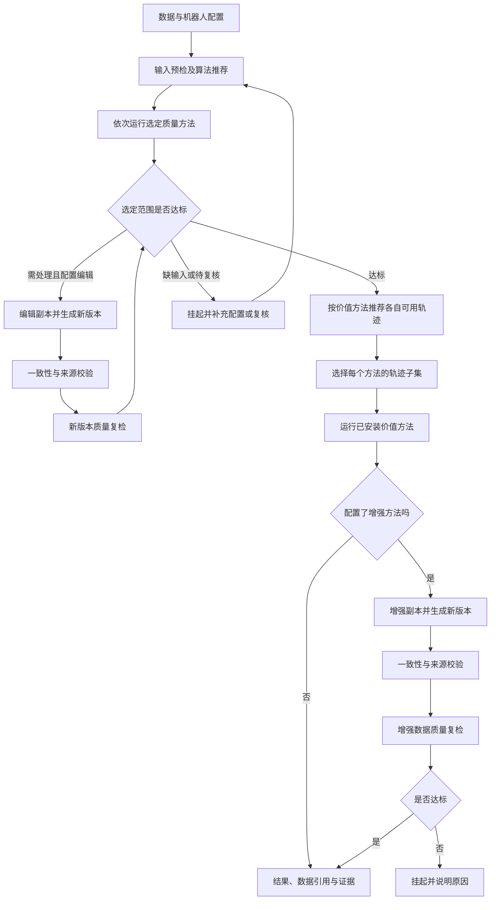

# 可选阶段与质量复检

`edc workflow` 在 `run` 的 SI 输入、算法注册、推荐和原始结果之上编排有限阶段。
它不修改算法公式、阈值或评分，不将价值结果换算为统一总分。



图中的返回路径以显式、有限的阶段列表展开；不会自动无限编辑，也不会猜测修复方法。
补充配置后重新执行，或保存复核记录后恢复执行。价值、编辑、增强阶段不配置方法时允许跳过。

## 用户输入

机器人 YAML 的 `arms` 描述机器人实际有几条臂，`checks.<方法>.arms` 选择默认检查范围。
工作流 `params.<方法>.arms` 可以覆盖本次范围。`all` 按机器人声明展开；左右不会互相回退。
机械臂 `main` 可用于没有左右含义的独立单臂。

```yaml
schema_version: edc_workflow_v1
id: task_curation
dataset:
  path: /data/task_dataset
  robot: ../configs/robots/example.yaml
stages:
  - id: quality
    kind: quality
    input: source
    algorithms: [Structure_Check, Action_Smoothness]
    params:
      Action_Smoothness: {arms: all}
  - id: value
    kind: value
    input: quality
    algorithms: []  # 暂未接入价值评估算法，保留接口并跳过
```

相对路径以工作流文件所在目录为准。每阶段的 `algorithms` 保留显式顺序。
`selection_policy: runnable` 可跳过推荐为不可运行的方法，但不能把已选方法的缺失评估当成质量通过。
每个阶段记录推荐、实际绑定、已选／保留的轨迹及原因。
价值方法的 `method_select: {算法ID: [轨迹ID]}` 可以进一步限定各自的数据子集；仍须满足各自预检。

```bash
edc workflow check workflow.yaml
edc workflow run workflow.yaml --output /tmp/edc-workflow-results
edc workflow run workflow.yaml --output /tmp/edc-workflow-results --resume
```

工作流保存完整生效配置、源指纹、阶段 run ID、结果、推荐及新数据引用。
`catalog.json` 的 `workflows` 字段指向 `_workflows/<id>/workflow.json` 与流程报告。
`status` 描述执行完成情况，`delivery_status: ready/suspended` 单独描述能否放行。
算法的统一结果仍保留 PASS、REVIEW、SALVAGE、EXCLUDE，不改写。
所选输入缺失、待复核、部分覆盖或执行失败时挂起；不能由分数满分替代完整检查。

人工复核可用 `edc.review(output, run_id=..., algorithm=..., object_id=..., instance_id="left",
action="dismissed", reviewer=..., reason=..., evidence=...)` 保存。
`confirmed` 表示确认违规，`dismissed` 表示排除可疑线索。
左右臂多实例须明确 `instance_id`；左臂的复核记录不能替右臂放行，也不能填补缺失评估。

## 开发者输入与输出

方法仍由 `AlgorithmSpec` 与 `run(context, params)` 注册，类别为 quality/value/editing/augmentation。
不新增通用 InputBase，也不改输出基类。上游结果由只读 `context.upstream` 传入。
编辑与增强须返回 `output / params / source_mapping`，新数据不能覆盖源文件。
当前变换验证器只接受行不增减、时间不变的 identity 映射；重复增强可生成多个新 episode。
有时间重采样、任意片段修改或通道增删的实际方法须扩展对应契约后才能接入。
每个编辑／增强输出分支都必须紧接质量阶段，否则配置检查失败。

## 合成示例

```bash
python -m venv /tmp/edc-workflow-env
. /tmp/edc-workflow-env/bin/activate
pip install './[formats]' ./examples/plugins/workflow
python examples/workflows/make_example.py --output /tmp/edc-workflow-demo
edc workflow run /tmp/edc-workflow-demo/workflow.yaml --output /tmp/edc-workflow-results
```

示例包括结构检查、图像亮度编辑、复检、集合盘点、图像增强与复检。
它仅证明阶段交接、SI 输入与来源验证；集合盘点不是估值算法，亮度变换不是经过验证的修复方法。
价值评估、编辑和增强算法需独立安装和验收。
示例使用独立环境；提供相同算法 ID 的插件不能同时注册。
