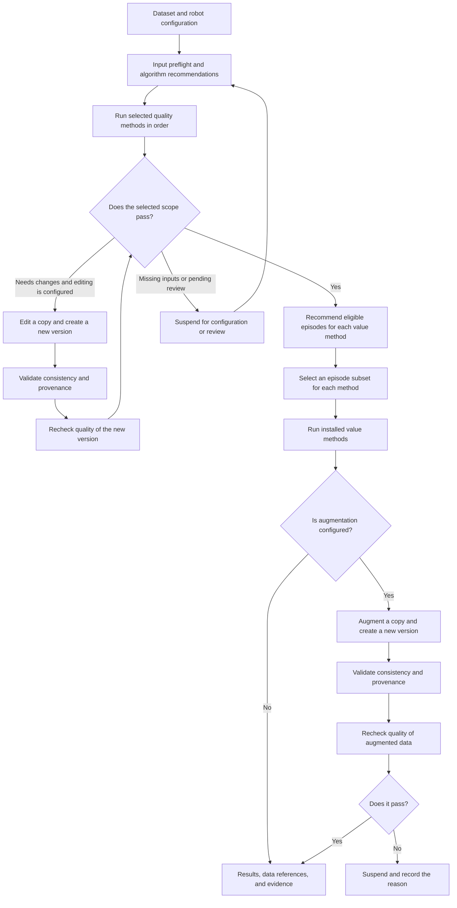

# Orchestrate and Run Quality Workflows

[简体中文](WORKFLOWS.en.md)

`edc workflow` connects quality checks, editing/augmentation, and rechecks through a finite stage list, and records the release decision.
It reuses the SI inputs, algorithm registry, recommendations, and raw results from `run`; it does not change formulas, thresholds, or scores, or create a cross-algorithm score.



The return paths in the diagram expand into explicit, finite stages; the workflow does not edit indefinitely or guess repairs.
Rerun after updating configuration, or resume after saving review records. Value, editing, and augmentation stages may be skipped when no methods are configured.

## User inputs

The robot YAML's `arms` declares the robot's actual arms; `checks.<method>.arms` selects the default check scope.
Workflow `params.<method>.arms` overrides the scope for this run. `all` expands the declared arms; left and right never fall back to each other.
Use `main` for a standalone arm with no left/right meaning.

```yaml
schema_version: edc_workflow_v1
id: task_curation
dataset:
  path: /data/task_dataset
  robot: ../configs/robots/example.yaml
stages:
  - id: quality
    kind: quality
    input: source
    algorithms: [Structure_Check, Action_Smoothness]
    params:
      Action_Smoothness: {arms: all}
  - id: value
    kind: value
    input: quality
    algorithms: []  # No value method integrated yet; retain the interface and skip
```

Relative paths resolve against the workflow file's directory. Each stage preserves the explicit order of `algorithms`.
`selection_policy: runnable` can skip methods recommended as non-runnable, but missing evaluations for selected methods cannot count as quality passes.
Each stage records recommendations, actual bindings, selected/retained episodes, and reasons.
For value methods, `method_select: {algorithm_id: [episode_id]}` further restricts each method's subset; each subset must still pass that method's preflight.

```bash
edc workflow check workflow.yaml
edc workflow run workflow.yaml --output /tmp/edc-workflow-results
edc workflow run workflow.yaml --output /tmp/edc-workflow-results --resume
```

The workflow saves the complete effective configuration, source fingerprints, stage run IDs, results, recommendations, and references to new data.
The `workflows` field in `catalog.json` points to `_workflows/<id>/workflow.json` and the workflow report.
`status` describes execution completion; `delivery_status: ready/suspended` separately describes whether the output can be released.
Algorithm results retain PASS, REVIEW, SALVAGE, and EXCLUDE unchanged.
Missing selected inputs, pending review, partial coverage, or execution failures suspend release; a perfect score cannot substitute for a complete evaluation.

Save manual reviews with `edc.review(output, run_id=..., algorithm=..., object_id=..., instance_id="left",
action="dismissed", reviewer=..., reason=..., evidence=...)`.
`confirmed` confirms a violation; `dismissed` dismisses a suspicious finding.
For multiple arm instances, specify `instance_id`: a left-arm review cannot release the right arm or fill a missing evaluation.

## Developer inputs and outputs

For registration, read-only `context.upstream`, transform return values, and validation boundaries, see [general plugins and context](../reference/OUTPUTS.md#plugins).
Repeated augmentation can create multiple new episodes. Every editing/augmentation output branch must be followed immediately by a quality stage, or configuration validation fails.

## Synthetic example

```bash
python -m venv /tmp/edc-workflow-env
. /tmp/edc-workflow-env/bin/activate
pip install './[formats]' ./examples/plugins/workflow
python examples/workflows/make_example.py --output /tmp/edc-workflow-demo
edc workflow run /tmp/edc-workflow-demo/workflow.yaml --output /tmp/edc-workflow-results
```

The example includes structure checks, image brightness editing, a recheck, collection inventory, image augmentation, and another recheck.
It demonstrates only stage handoff, SI inputs, and provenance validation. Collection inventory is not a valuation algorithm; brightness transforms are not validated repairs.
Value, editing, and augmentation algorithms require separate installation and acceptance checks.
Use an isolated environment for the example; plugins providing the same algorithm ID cannot be registered together.
