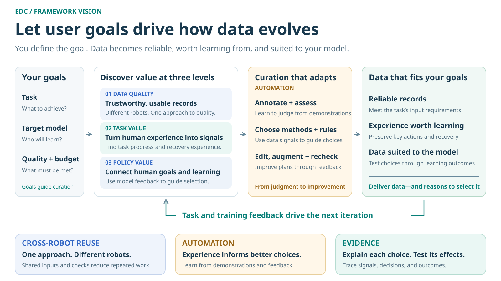

# EDC · Embodied Data Curation

:::{container} edc-intro
Turn usable robot data into experience worth learning from.
:::

**EDC = Embodied Data Curation.** For data users and algorithm developers,
the framework connects data readers, robot configuration, quality checks,
reports, and evidence to make data selection traceable.

## Documentation

::::{grid} 1 2 2 2
:gutter: 3

:::{grid-item-card} Tutorial · Quick start
:link: tutorial/QUICKSTART
:link-type: doc

Install, prepare data, and produce the first report end to end.
:::

:::{grid-item-card} How-to guides
:link: how-to/index.en
:link-type: doc

Connect data, run algorithms, export data, orchestrate workflows, write plugins.
:::

:::{grid-item-card} Reference
:link: reference/index.en
:link-type: doc

Formats, fields, units, algorithm parameters, output objects, and commands.
:::

:::{grid-item-card} Explanation
:link: explanation/index.en
:link-type: doc

What data quality means, design choices, evidence limits, and research foundations.
:::

::::

## Getting started

| Task | Entry point |
|---|---|
| Install and run a complete example | [Tutorial: quick start](tutorial/QUICKSTART.md) |
| Connect a recording | [Connect data and configure a robot](how-to/DATA_AND_ROBOT.md) |
| Select applicable checks | [Recommend, select, and run algorithms](how-to/RUN_AND_SELECT.md) |
| Export selected data | [Select and export data by report](how-to/SELECTION.en.md) |
| Extend algorithms or formats | [Add a quality algorithm](how-to/ALGORITHM_PLUGIN.md) · [Add a reader plugin](how-to/READER_PLUGIN.md) |
| Review research foundations and validation | [From quality checks to autonomous data curation](explanation/QUALITY_VALIDATION.md) |

EDC provides data quality checks and evidence-based selection. Task-value and policy-value methods are planned; see [research foundations and validation](explanation/QUALITY_VALIDATION.md).

## Framework overview



## Run checks and use the results

With a recording and a matching robot configuration:

```bash
edc batch /path/to/dataset/episode.mcap \
  --robot configs/robots/x1pro_mcap.yaml \
  --output /path/to/results/report.html --jobs 1
```

Open the report in a browser to inspect conclusions, reasons, and evidence by recording or algorithm.
Use [`edc regenerate`](how-to/SELECTION.en.md) to export selected data. Successful execution,
passing quality checks, and workflow clearance are separate outcomes.
For a first run, follow the [tutorial](tutorial/QUICKSTART.md).
