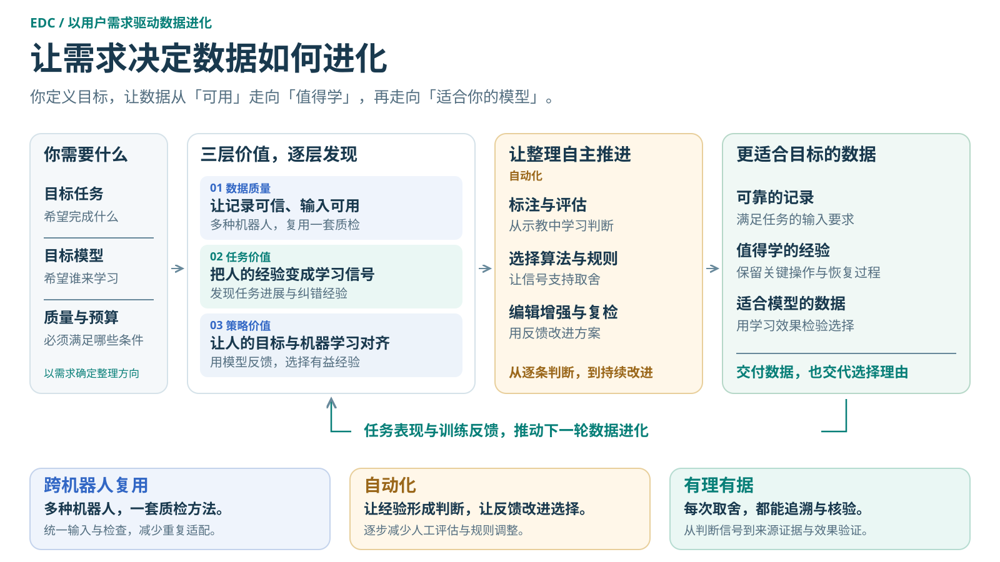

# EDC · 具身数据整理框架

:::{container} edc-intro
让机器人数据，从“可用”走向“值得学”。
:::

**EDC = Embodied Data Curation**。面向具身数据使用者与算法开发者，
通过数据读取、机器人配置、质量检查、报告与证据，为数据选择提供可追溯的依据。

::::{grid} 1 2 2 2
:gutter: 3

:::{grid-item-card} 快速开始
:link: QUICKSTART.zh-CN
:link-type: doc

准备数据与配置，运行九项内置质量检查，查看报告。
:::

:::{grid-item-card} 数据与机器人配置
:link: DATA_AND_CONFIGURATION.zh-CN
:link-type: doc

查看已有格式与配置，明确字段、机械臂、单位、时钟与标定。
:::

:::{grid-item-card} 推荐与算法选择
:link: ALGORITHMS.zh-CN
:link-type: doc

根据当前输入选择方法，了解各项质量检查的依据与边界。
:::

:::{grid-item-card} 算法开发
:link: DEVELOPMENT.zh-CN
:link-type: doc

使用 QualityAlgorithm、AlgorithmSpec 和统一输出接口接入插件。
:::

::::

## 框架概览



当前提供数据质量检查；任务价值与策略价值的方法将逐步接入框架。
具体研究依据与验证边界见[从质量检查到自主数据整理](QUALITY_VALIDATION.zh-CN.md)。

## 运行与使用结果

已有数据与匹配的机器人配置后，可执行：

```bash
edc batch /path/to/dataset/episode.mcap \
  --robot configs/robots/x1pro_mcap.yaml \
  --output /path/to/results/report.html --jobs 1
```

浏览器打开报告，按轨迹和算法查看结论、原因与证据；需要导出时使用
[`edc regenerate`](SELECTION.md)。运行成功、数据质量通过和工作流放行分别表达。

```{toctree}
:hidden:
:maxdepth: 1

快速开始 <QUICKSTART.zh-CN>
数据与配置 <DATA_AND_CONFIGURATION.zh-CN>
算法指南 <ALGORITHMS.zh-CN>
筛选与导出 <SELECTION>
```

```{toctree}
:hidden:
:maxdepth: 1

算法开发 <DEVELOPMENT.zh-CN>
工作流与复检 <WORKFLOWS>
证据与检查范围 <EVIDENCE_AND_SCOPE>
研究方向与验证 <QUALITY_VALIDATION.zh-CN>
贡献与维护 <DOCUMENTATION>
```

```{toctree}
:hidden:
:maxdepth: 1

Overview <index.en>
Quickstart <QUICKSTART>
Data and configuration <DATA_AND_CONFIGURATION>
Algorithms <ALGORITHMS>
Development <DEVELOPMENT>
Research and validation <QUALITY_VALIDATION>
```
